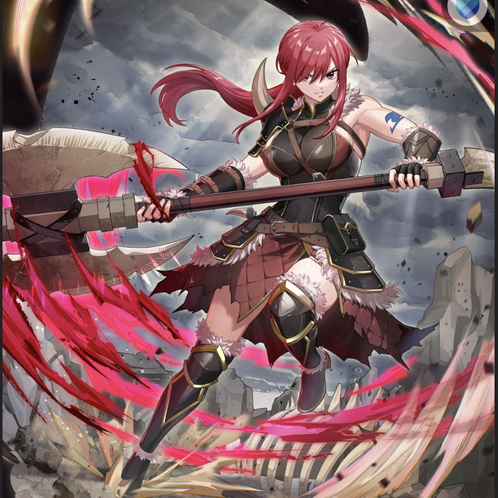

**Rarity:** UR

**Attribute:** ❤️ Brave

**Class:** Disrupt

**Identity:** Erza Scarlet

**Normal attack range:** Ranged

**Signature lacrima:** [[lacrimas/otherworld-adventure-erza-lacrima-0a37e1c7|✨ Otherworld Adventure Erza Lacrima]]

## Game text

### 🗡️ Normal Skill (Ranged)

Deals damage equal to 160% of ATK to the target. After the attack hits, has a 30% chance to  inflict &#91;Top&#93; Critical Resistance Decrease and &#91;Top&#93; Critical Rate Decrease on the target for 3 sec.

### 🗡️ Special Skill – Astral Break

After a normal skill hits, if an enemy within the target area is afflicted with Paralysis, Burn, or Bleed, inflicts &#91;Top&#93; DEF Decrease and &#91;Top&#93; Evasion Rate Decrease and &#91;Top&#93; ATK Decrease on each affected enemy for 5 sec.

### 💥 Ultimate – Earth-Splitting Roaring Slash

Every 10 sec, deals damage equal to 900% of ATK to enemies within the target area. After the attack hits, inflicts Heal Block and &#91;Top&#93; Bleed on each target for 7 sec. Extends the duration of the additional effects by 0.5 sec for each Bravery-type ally (max 3 sec).

## Effect applications

### Top Critical Resistance Decrease
| Property | Value |
| --- | --- |
| Family | Critical Resistance |
| Target | Single Enemy |
| Activation | Normal SKill Hit |
| Chance | 30% |
| Duration | 3 sec |
| Value | 20 Percent |
| Source skill | Normal Attack |

Deals damage equal to 160% of ATK to the target. After the attack hits, has a 30% chance to  inflict &#91;Top&#93; Critical Resistance Decrease and &#91;Top&#93; Critical Rate Decrease on the target for 3 sec.

### Top Critical Rate Decrease
| Property | Value |
| --- | --- |
| Family | Critical Rate |
| Target | Single Enemy |
| Activation | Normal SKill Hit |
| Chance | 30% |
| Duration | 3 sec |
| Value | 20 Percent |
| Source skill | Normal Attack |

Deals damage equal to 160% of ATK to the target. After the attack hits, has a 30% chance to  inflict &#91;Top&#93; Critical Resistance Decrease and &#91;Top&#93; Critical Rate Decrease on the target for 3 sec.

### Top DEF Decrease
| Property | Value |
| --- | --- |
| Family | DEF |
| Target | Enemies in Target Area |
| Activation | Normal SKill Hit |
| Duration | 5 sec |
| Value | 30 Percent |
| Required effects | Paralysis, Bleed, Burn |
| Match rule | Any |
| Condition subject | Target |
| Evaluation timing | After Attack Hits |
| Required state | Present |
| Source skill | Special Skill |

After a normal skill hits, if an enemy within the target area is afflicted with Paralysis, Burn, or Bleed, inflicts &#91;Top&#93; DEF Decrease and &#91;Top&#93; Evasion Rate Decrease and &#91;Top&#93; ATK Decrease on each affected enemy for 5 sec.

### Top Evasion Decrease
| Property | Value |
| --- | --- |
| Family | Evasion |
| Target | Enemies in Target Area |
| Activation | Normal SKill Hit |
| Duration | 5 sec |
| Value | 20 Percent |
| Required effects | Bleed, Burn, Paralysis |
| Match rule | Any |
| Condition subject | Target |
| Evaluation timing | After Attack Hits |
| Required state | Present |
### Top ATK Decrease
| Property | Value |
| --- | --- |
| Family | ATK |
| Target | Enemies in Target Area |
| Activation | Normal SKill Hit |
| Duration | 5 sec |
| Value | 30 Percent |
| Required effects | Paralysis, Burn, Bleed |
| Match rule | Any |
| Condition subject | Target |
| Evaluation timing | After Attack Hits |
| Required state | Present |
| Source skill | Special Skill |

After a normal skill hits, if an enemy within the target area is afflicted with Paralysis, Burn, or Bleed, inflicts &#91;Top&#93; DEF Decrease and &#91;Top&#93; Evasion Rate Decrease and &#91;Top&#93; ATK Decrease on each affected enemy for 5 sec.

### Heal Block
| Property | Value |
| --- | --- |
| Family | Heal Block |
| Target | Each Target Hit |
| Activation | Every 10 sec, After Attack Hits |
| Duration | 7 sec |
| Source skill | Ultimate |

Every 10 sec, deals damage equal to 900% of ATK to enemies within the target area. After the attack hits, inflicts Heal Block and &#91;Top&#93; Bleed on each target for 7 sec. Extends the duration of the additional effects by 0.5 sec for each Bravery-type ally (max 3 sec).

### Top Bleed
| Property | Value |
| --- | --- |
| Family | Bleed |
| Target | Each Target Hit |
| Activation | Every 10 sec, After Attack Hits |
| Duration | 7 sec |
| Value | 40 Percent of ATK per sec |
| Source skill | Ultimate |

Every 10 sec, deals damage equal to 900% of ATK to enemies within the target area. After the attack hits, inflicts Heal Block and &#91;Top&#93; Bleed on each target for 7 sec. Extends the duration of the additional effects by 0.5 sec for each Bravery-type ally (max 3 sec).

Unspecified values remain unknown. Text is transcribed from game records; localization and entry errors may remain.
