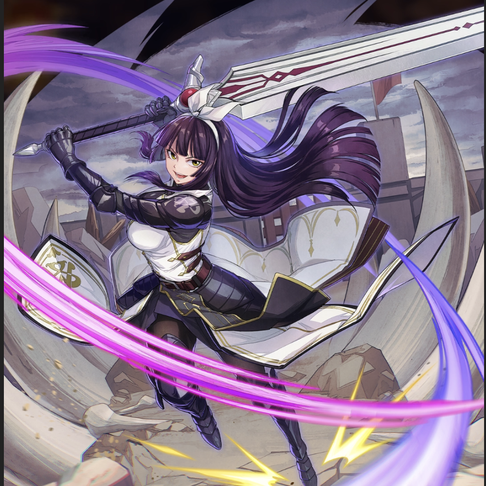

**Rarity:** UR

**Attribute:** 💚 Technique

**Class:** Ranged

**Identity:** Kagura Mikazuchi

**Normal attack range:** Ranged

**Signature lacrima:** [[lacrimas/otherworld-adventure-kagura-lacrima-8a3fd5cf|✨ Otherworld Adventure Kagura Lacrima]]

## Game text

### 🗡️ Normal Skill (Ranged)

Deals damage equal to 170% of ATK to the target. When a critical hit occurs, grants all Technique-type allies &#91;High&#93; ATK Increase and &#91;High&#93; Critical Damage Increase for 3 sec.

### 🗡️ Special Skill – Overwhelming Sword Strike

After a normal skill hits, has a 30% chance to inflict Silence and &#91;Top&#93; Critical DEF Decrease on the target for 5 sec, and reduces the currently accumulated Ultimate Skill Gauge by 0.9 sec.

### 💥 Ultimate – Heavy Swordsmanship: &quot;Whirl&quot; Form

Every 10 sec, deals damage equal to 950% of ATK to enemies within the target area. After the attack hits, has a 40% chance to inflict &#91;Top&#93; Bleed and &#91;Top&#93; Burn on each target for 5 sec.

## Effect applications

### High ATK Increase
| Property | Value |
| --- | --- |
| Family | ATK |
| Target | Technique Allies |
| Activation | Critical Hit |
| Duration | 3 sec |
| Value | 25 Percent |
| Source skill | Normal Attack |

Deals damage equal to 170% of ATK to the target. When a critical hit occurs, grants all Technique-type allies &#91;High&#93; ATK Increase and &#91;High&#93; Critical Damage Increase for 3 sec.

### High Critical Damage Increase
| Property | Value |
| --- | --- |
| Family | Critical Damage |
| Target | Technique Allies |
| Activation | Critical Hit |
| Duration | 3 sec |
| Value | 40 Percent |
| Source skill | Normal Attack |

Deals damage equal to 170% of ATK to the target. When a critical hit occurs, grants all Technique-type allies &#91;High&#93; ATK Increase and &#91;High&#93; Critical Damage Increase for 3 sec.

### Silence
| Property | Value |
| --- | --- |
| Family | Silence |
| Target | Single Enemy |
| Activation | Normal SKill Hit |
| Chance | 30% |
| Duration | 5 sec |
| Source skill | Special Skill |

After a normal skill hits, has a 30% chance to inflict Silence and &#91;Top&#93; Critical DEF Decrease on the target for 5 sec, and reduces the currently accumulated Ultimate Skill Gauge by 0.9 sec.

### Top Critical Defense Decrease
| Property | Value |
| --- | --- |
| Family | Critical Defense |
| Target | Single Enemy |
| Activation | Normal SKill Hit |
| Chance | 30% |
| Duration | 5 sec |
| Value | 50 Percent |
### Push Back Ultimate Skill Gauge
| Property | Value |
| --- | --- |
| Family | Ultimate Skill Gauge |
| Target | Single Enemy |
| Activation | Normal SKill Hit |
| Chance | 30% |
| Value | 0.9 Seconds |
### Top Bleed
| Property | Value |
| --- | --- |
| Family | Bleed |
| Target | Each Target Hit |
| Activation | Every 10 sec, After Attack Hits |
| Chance | 40% |
| Duration | 5 sec |
| Value | 40 Percent of ATK per sec |
| Source skill | Ultimate |

Every 10 sec, deals damage equal to 950% of ATK to enemies within the target area. After the attack hits, has a 40% chance to inflict &#91;Top&#93; Bleed and &#91;Top&#93; Burn on each target for 5 sec.

### Top Burn
| Property | Value |
| --- | --- |
| Family | Burn |
| Target | Each Target Hit |
| Activation | Every 10 sec, After Attack Hits |
| Chance | 40% |
| Duration | 5 sec |
| Value | 30 Percent of ATK per sec |
| Source skill | Ultimate |

Every 10 sec, deals damage equal to 950% of ATK to enemies within the target area. After the attack hits, has a 40% chance to inflict &#91;Top&#93; Bleed and &#91;Top&#93; Burn on each target for 5 sec.

Unspecified values remain unknown. Text is transcribed from game records; localization and entry errors may remain.
