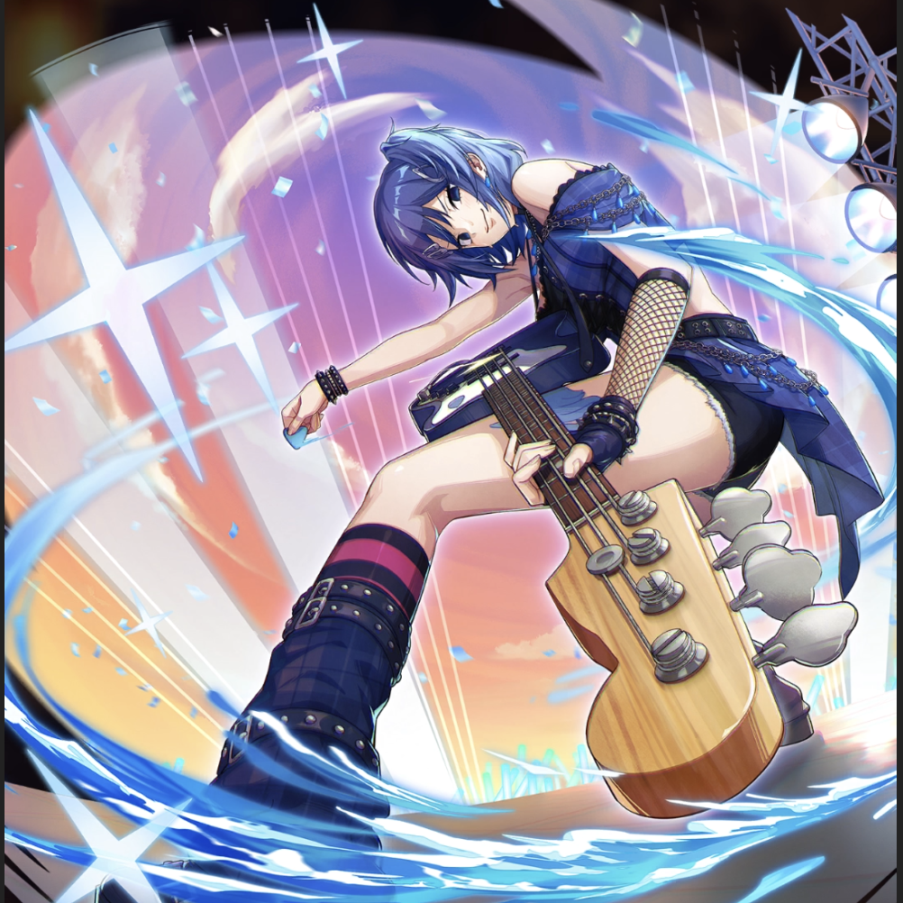

**Rarity:** UR

**Attribute:** 💙 Mind

**Class:** Defense

**Identity:** Juvia Lockser

**Normal attack range:** Ranged

**Signature lacrima:** [[lacrimas/rock-n-magic-juvia-lacrima-1f479c22|✨ Rock'n Magic Juvia Lacrima]]

## Game text

### 🗡️ Normal Skill (Ranged)

Deals 170% ATK damage to the target. After the attack hits has a 30% chance to restore own HP by 700% of ATK and grants &#91;High&#93; Shield for 3 sec.

### 🗡️ Special Skill – Soul Stirring Rock &#x27;n Roll

While on the field, grants all allies &#91;Top&#93; DEF Increase and &#91;Top&#93; Critical DEF Increase

### 💥 Ultimate – Rain the Rock

Every 8 sec, deals 850% ATK damage to targets within range. After the attack hits, grants self Critical Shield and &#91;Top&#93; Continuous Healing, &#91;Top&#93; ATK Increase for 7 sec and restores own HP by 1000% of ATK. ​Also has a 50% chance for each ally to grant &#91;Top&#93; ATK Increase and Critical Shield for 5 sec.

## Effect applications

### Heal
| Property | Value |
| --- | --- |
| Family | Heal |
| Target | Self |
| Activation | Normal SKill Hit |
| Chance | 30% |
| Value | 700 Percent of own ATK |
| Source skill | Normal Attack |

Deals 170% ATK damage to the target. After the attack hits has a 30% chance to restore own HP by 700% of ATK and grants &#91;High&#93; Shield for 3 sec.

### High Shield
| Property | Value |
| --- | --- |
| Family | Shield |
| Target | Self |
| Activation | Normal SKill Hit |
| Chance | 30% |
| Duration | 3 sec |
| Value | 20 Percent of Max HP |
| Source skill | Normal Attack |

Deals 170% ATK damage to the target. After the attack hits has a 30% chance to restore own HP by 700% of ATK and grants &#91;High&#93; Shield for 3 sec.

### Top DEF Increase
| Property | Value |
| --- | --- |
| Family | DEF |
| Target | All Allies |
| Activation | While Unit is on the Field |
| Value | 30 Percent |
| Source skill | Special Skill |

While on the field, grants all allies &#91;Top&#93; DEF Increase and &#91;Top&#93; Critical DEF Increase

### Top Critical Defense Increase
| Property | Value |
| --- | --- |
| Family | Critical Defense |
| Target | All Allies |
| Activation | While Unit is on the Field |
| Value | 50 Percent |
### Critical Shield
| Property | Value |
| --- | --- |
| Family | Critical Shield |
| Target | Self |
| Activation | Every 8 sec, After Attack Hits |
| Duration | 7 sec |
| Source skill | Ultimate |

Every 8 sec, deals 850% ATK damage to targets within range. After the attack hits, grants self Critical Shield and &#91;Top&#93; Continuous Healing, &#91;Top&#93; ATK Increase for 7 sec and restores own HP by 1000% of ATK. ​Also has a 50% chance for each ally to grant &#91;Top&#93; ATK Increase and Critical Shield for 5 sec.

### Top Continuous Heal
| Property | Value |
| --- | --- |
| Family | Heal |
| Target | Self |
| Activation | Every 8 sec, After Attack Hits |
| Duration | 7 sec |
| Value | 120 Percent of ATK per sec |
| Source skill | Ultimate |

Every 8 sec, deals 850% ATK damage to targets within range. After the attack hits, grants self Critical Shield and &#91;Top&#93; Continuous Healing, &#91;Top&#93; ATK Increase for 7 sec and restores own HP by 1000% of ATK. ​Also has a 50% chance for each ally to grant &#91;Top&#93; ATK Increase and Critical Shield for 5 sec.

### Top ATK Increase
| Property | Value |
| --- | --- |
| Family | ATK |
| Target | Self |
| Activation | Every 8 sec, After Attack Hits |
| Duration | 7 sec |
| Value | 30 Percent |
| Source skill | Ultimate |

Every 8 sec, deals 850% ATK damage to targets within range. After the attack hits, grants self Critical Shield and &#91;Top&#93; Continuous Healing, &#91;Top&#93; ATK Increase for 7 sec and restores own HP by 1000% of ATK. ​Also has a 50% chance for each ally to grant &#91;Top&#93; ATK Increase and Critical Shield for 5 sec.

### Heal
| Property | Value |
| --- | --- |
| Family | Heal |
| Target | Self |
| Activation | Every 8 sec, After Attack Hits |
| Value | 1000 Percent of own ATK |
| Source skill | Ultimate |

Every 8 sec, deals 850% ATK damage to targets within range. After the attack hits, grants self Critical Shield and &#91;Top&#93; Continuous Healing, &#91;Top&#93; ATK Increase for 7 sec and restores own HP by 1000% of ATK. ​Also has a 50% chance for each ally to grant &#91;Top&#93; ATK Increase and Critical Shield for 5 sec.

### Top ATK Increase
| Property | Value |
| --- | --- |
| Family | ATK |
| Target | All Allies |
| Activation | Every 8 sec, After Attack Hits |
| Chance | 50% |
| Duration | 5 sec |
| Value | 30 Percent |
| Source skill | Ultimate |

Every 8 sec, deals 850% ATK damage to targets within range. After the attack hits, grants self Critical Shield and &#91;Top&#93; Continuous Healing, &#91;Top&#93; ATK Increase for 7 sec and restores own HP by 1000% of ATK. ​Also has a 50% chance for each ally to grant &#91;Top&#93; ATK Increase and Critical Shield for 5 sec.

### Critical Shield
| Property | Value |
| --- | --- |
| Family | Critical Shield |
| Target | All Allies |
| Activation | Every 8 sec, After Attack Hits |
| Chance | 50% |
| Duration | 5 sec |
| Source skill | Ultimate |

Every 8 sec, deals 850% ATK damage to targets within range. After the attack hits, grants self Critical Shield and &#91;Top&#93; Continuous Healing, &#91;Top&#93; ATK Increase for 7 sec and restores own HP by 1000% of ATK. ​Also has a 50% chance for each ally to grant &#91;Top&#93; ATK Increase and Critical Shield for 5 sec.

Unspecified values remain unknown. Text is transcribed from game records; localization and entry errors may remain.
