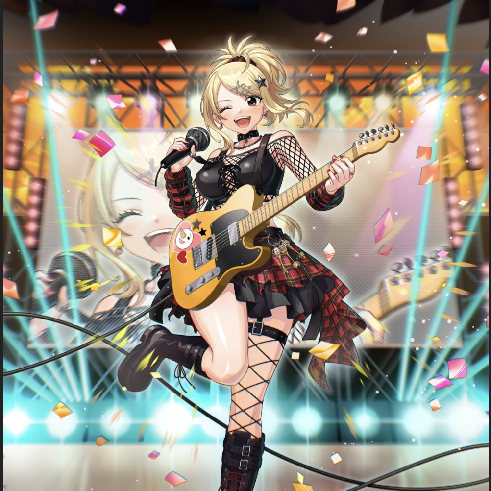

**Rarity:** UR

**Attribute:** ❤️ Brave

**Class:** Ranged

**Identity:** Lucy Heartfilia

**Normal attack range:** Ranged

**Signature lacrima:** [[lacrimas/rock-n-magic-lucy-lacrima-3d2f2321|✨ Rock'n Magic Lucy Lacrima]]

## Game text

### 🗡️ Normal Skill (Ranged)

Deals 170% ATK damage to the target. When a critical hit occurs, grants all Courage-type allies &#91;High&#93; ATK Increase and &#91;High&#93; Critical Rate Increase for 3 sec.

### 🗡️ Special Skill – Acid Music

After a Normal Skill hits, if enemies within the target&#x27;s range are affected by Paralysis or Burn, inflicts &#91;High&#93; Bleed and &#91;Top&#93; Critical Resistance Decrease, Heal Block on each enemy for 5 sec.

### 💥 Ultimate – Star the Rock

Every 10 sec, deals 950% ATK damage to targets within range. After the attack hits,  has a 40% chance for each target to inflict &#91;Top&#93; Critical DEF Decrease and &#91;High&#93; Burn, &#91;High&#93; Freeze for 5 sec. Extends the duration of these additional effects by 0.5 sec for each Courage-type ally (up to 3.5 sec).

## Effect applications

### High ATK Increase
| Property | Value |
| --- | --- |
| Family | ATK |
| Target | Brave Allies |
| Activation | Critical Hit |
| Duration | 3 sec |
| Value | 25 Percent |
| Source skill | Normal Attack |

Deals 170% ATK damage to the target. When a critical hit occurs, grants all Courage-type allies &#91;High&#93; ATK Increase and &#91;High&#93; Critical Rate Increase for 3 sec.

### High Critical Rate Increase
| Property | Value |
| --- | --- |
| Family | Critical Rate |
| Target | Brave Allies |
| Activation | Critical Hit |
| Duration | 3 sec |
| Value | 15 Percent |
| Source skill | Normal Attack |

Deals 170% ATK damage to the target. When a critical hit occurs, grants all Courage-type allies &#91;High&#93; ATK Increase and &#91;High&#93; Critical Rate Increase for 3 sec.

### High Bleed
| Property | Value |
| --- | --- |
| Family | Bleed |
| Target | Enemies in Target Area |
| Activation | Normal SKill Hit |
| Duration | 5 sec |
| Value | 35 Percent of ATK per sec |
| Required effects | Paralysis, Burn |
| Match rule | Any |
| Condition subject | Target |
| Evaluation timing | After Attack Hits |
| Required state | Present |
### Top Critical Resistance Decrease
| Property | Value |
| --- | --- |
| Family | Critical Resistance |
| Target | Enemies in Target Area |
| Activation | Normal SKill Hit |
| Duration | 5 sec |
| Value | 20 Percent |
| Required effects | Paralysis, Burn |
| Match rule | Any |
| Condition subject | Target |
| Evaluation timing | After Attack Hits |
| Required state | Present |
### Heal Block
| Property | Value |
| --- | --- |
| Family | Heal Block |
| Target | Enemies in Target Area |
| Activation | Normal SKill Hit |
| Duration | 5 sec |
| Required effects | Paralysis, Burn |
| Match rule | Any |
| Condition subject | Target |
| Evaluation timing | After Attack Hits |
| Required state | Present |
### Top Critical Defense Decrease
| Property | Value |
| --- | --- |
| Family | Critical Defense |
| Target | Each Target Hit |
| Activation | Every 10 sec, After Attack Hits |
| Chance | 40% |
| Duration | 5 sec |
| Value | 50 Percent |
### High Burn
| Property | Value |
| --- | --- |
| Family | Burn |
| Target | Each Target Hit |
| Activation | Every 10 sec, After Attack Hits |
| Chance | 40% |
| Duration | 5 sec |
| Value | 25 Percentage of Source ATK per second |
| Source skill | Ultimate |

Every 10 sec, deals 950% ATK damage to targets within range. After the attack hits,  has a 40% chance for each target to inflict &#91;Top&#93; Critical DEF Decrease and &#91;High&#93; Burn, &#91;High&#93; Freeze for 5 sec. Extends the duration of these additional effects by 0.5 sec for each Courage-type ally (up to 3.5 sec).

### High Freeze
| Property | Value |
| --- | --- |
| Family | Freeze |
| Target | Each Target Hit |
| Activation | Every 10 sec, After Attack Hits |
| Chance | 40% |
| Duration | 5 sec |
| Source skill | Ultimate |

Every 10 sec, deals 950% ATK damage to targets within range. After the attack hits,  has a 40% chance for each target to inflict &#91;Top&#93; Critical DEF Decrease and &#91;High&#93; Burn, &#91;High&#93; Freeze for 5 sec. Extends the duration of these additional effects by 0.5 sec for each Courage-type ally (up to 3.5 sec).

Unspecified values remain unknown. Text is transcribed from game records; localization and entry errors may remain.
