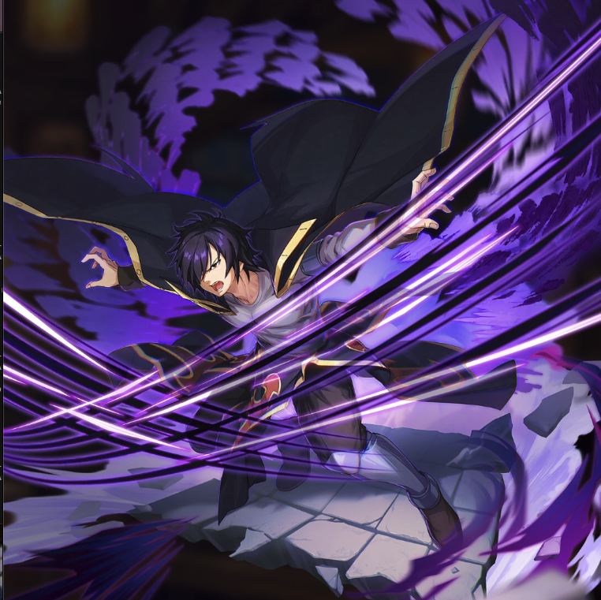

**Rarity:** UR

**Attribute:** 💚 Technique

**Class:** Melee

**Identity:** Rogue Cheney

**Normal attack range:** Melee

**Signature lacrima:** [[lacrimas/rogue-lacrima-05579bc2|✨ Rogue Lacrima]]

## Game text

### 🗡️ Normal Skill (Melee)

Deals 140% ATK damage to the target.

### 🗡️ Special Skill - Shadow Drive

After a normal skill hits, there is a 20% chance to grant yourself for 5 sec &#91;Top&#93; Evasion Increase.

### 💥 Ultimate - Shadow Dragon Flash Swallow

Every 10 sec, deal damage equal to 750% of ATK to enemies within the target area.

## Effect applications

### Top Evasion Increase
| Property | Value |
| --- | --- |
| Family | Evasion |
| Target | Self |
| Activation | Normal SKill Hit |
| Chance | 20% |
| Duration | 5 sec |
| Value | 20 Percent |
| Source skill | Special Skill |

After a normal skill hits, there is a 20% chance to grant yourself for 5 sec &#91;Top&#93; Evasion Increase.

Unspecified values remain unknown. Text is transcribed from game records; localization and entry errors may remain.
