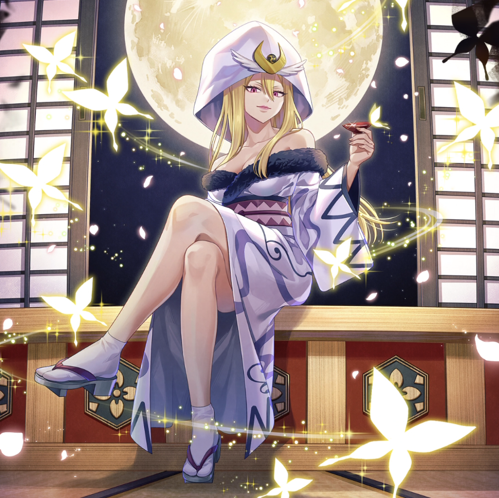

**Rarity:** UR

**Attribute:** 💙 Mind

**Class:** Ranged

**Identity:** Selene

**Normal attack range:** Ranged

**Signature lacrima:** [[lacrimas/selene-lacrima-19a2d8cd|✨ Selene Lacrima]]

## Game text

### 🗡️ Normal Skill (Ranged)

Deals damage equal to 180% of ATK to the target. After the attack hits, has a 30% chance to inflict &#91;High&#93; Critical Defense Decrease and Silence on the target for 3 sec.

### 🗡️ Special Skill - Moonlit Conflagration

After a normal skill hits, has a 20% chance to deal 350% damage to enemies within the target area. If the target is afflicted with Burn, Paralysis, Silence, or Bleed after the attack hits, deals additional damage equal to 350% of ATK.

### 💥 Ultimate – Moonlight Butterflies

Every 11 sec, deals damage equal to 950% of ATK to all enemies. After the attack hits, grants self Invincible, &#91;Top&#93; ATK Increase, and &#91;Top&#93; Critical Damage Increase for 5 sec.

## Effect applications

### High Critical Defense Decrease
| Property | Value |
| --- | --- |
| Family | Critical Defense |
| Target | Single Enemy |
| Activation | Normal SKill Hit |
| Chance | 30% |
| Duration | 3 sec |
| Value | 40 Percent |
| Source skill | Normal Attack |

Deals damage equal to 180% of ATK to the target. After the attack hits, has a 30% chance to inflict &#91;High&#93; Critical Defense Decrease and Silence on the target for 3 sec.

### Silence
| Property | Value |
| --- | --- |
| Family | Silence |
| Target | Single Enemy |
| Activation | Normal SKill Hit |
| Chance | 30% |
| Duration | 3 sec |
| Source skill | Normal Attack |

Deals damage equal to 180% of ATK to the target. After the attack hits, has a 30% chance to inflict &#91;High&#93; Critical Defense Decrease and Silence on the target for 3 sec.

### Additional Damage
| Property | Value |
| --- | --- |
| Family | Damage |
| Target | Each Target Hit |
| Activation | Normal SKill Hit |
| Parent skill chance | 20% |
| Value | 350 Percent of own ATK |
| Required effects | Burn, Paralysis, Bleed, Silence |
| Match rule | Any |
| Condition subject | Target Hit |
| Evaluation timing | After Attack Hits |
| Required state | Present |
| Source skill | Special Skill |

If the target is affected with Burn, Paralysis, Silence, or Bleed after the attack hits, deals additional damage equal to 350% of ATK.

### Invincible
| Property | Value |
| --- | --- |
| Family | Invincible |
| Target | Self |
| Activation | Every 11 sec, After Attack Hits |
| Duration | 5 sec |
| Source skill | Ultimate |

Every 11 sec, deals damage equal to 950% of ATK to all enemies. After the attack hits, grants self Invincible, &#91;Top&#93; ATK Increase, and &#91;Top&#93; Critical Damage Increase for 5 sec.

### Top ATK Increase
| Property | Value |
| --- | --- |
| Family | ATK |
| Target | Self |
| Activation | Every 11 sec, After Attack Hits |
| Duration | 5 sec |
| Value | 30 Percent |
| Source skill | Ultimate |

Every 11 sec, deals damage equal to 950% of ATK to all enemies. After the attack hits, grants self Invincible, &#91;Top&#93; ATK Increase, and &#91;Top&#93; Critical Damage Increase for 5 sec.

### Top Critical Damage Increase
| Property | Value |
| --- | --- |
| Family | Critical Damage |
| Target | Self |
| Activation | Every 11 sec, After Attack Hits |
| Duration | 5 sec |
| Value | 50 Percent |
| Source skill | Ultimate |

Every 11 sec, deals damage equal to 950% of ATK to all enemies. After the attack hits, grants self Invincible, &#91;Top&#93; ATK Increase, and &#91;Top&#93; Critical Damage Increase for 5 sec.

Unspecified values remain unknown. Text is transcribed from game records; localization and entry errors may remain.
