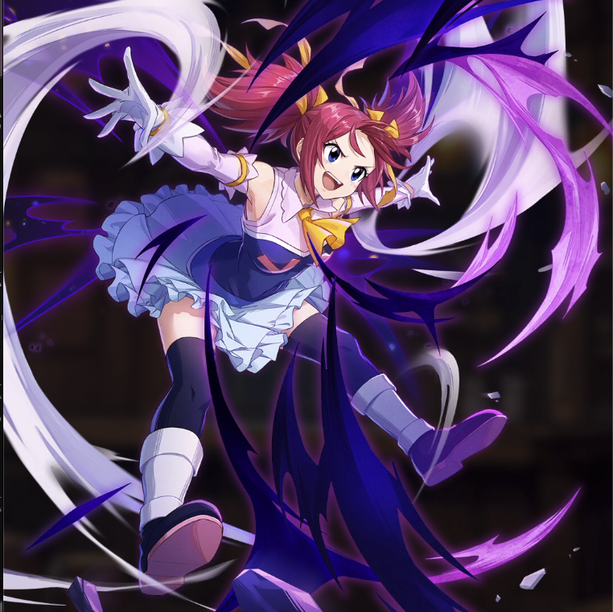

**Rarity:** UR

**Attribute:** 💛 Heart

**Class:** Melee

**Identity:** Sherria Blendy

**Normal attack range:** Melee

**Signature lacrima:** [[lacrimas/sherria-lacrima-760310ed|✨ Sherria Lacrima]]

## Game text

### 🗡️ Normal Skill (Melee)

Deals 140% ATK damage to the target.

### 🗡️ Special Skill - Protection of the Heavenly Gods

Every 6 sec, heal your own HP by 200% of ATK.

### 💥 Ultimate - Thunder Roar of the Heavenly God

Every 9 sec, deal damage equal to 750% of ATK to enemies within the target area.

## Effect applications

### Heal
| Property | Value |
| --- | --- |
| Family | Heal |
| Target | Self |
| Activation | Every 6 sec |
| Value | 200 Percent of own ATK |
| Source skill | Special Skill |

Every 6 sec, heal your own HP by 200% of ATK

Unspecified values remain unknown. Text is transcribed from game records; localization and entry errors may remain.
