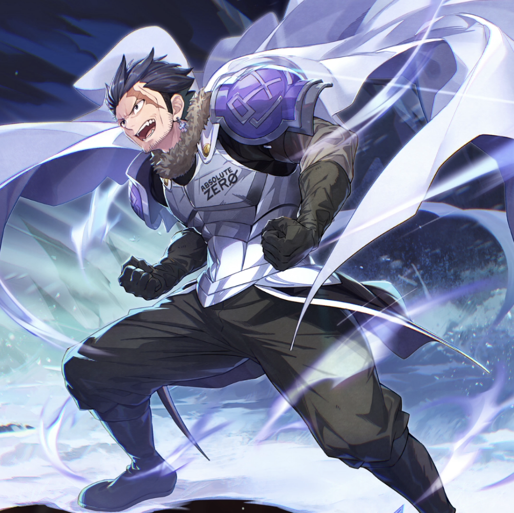

**Rarity:** UR

**Attribute:** 💙 Mind

**Class:** Melee

**Identity:** Silver Fullbuster

**Normal attack range:** Melee

**Signature lacrima:** [[lacrimas/silver-lacrima-c71add80|✨ Silver Lacrima]]

## Game text

### Normal Attack (Melee)

Deals 140% ATK damage to the target.

### Special Skill – Absolute Zero

After a normal skill hits, there is a 10% chance to inflict on the target for 4 sec, &#91;High&#93; Freeze.

### Ultimate – Rage of the Ice Demon

Every 10 sec, deal damage equal to 700% of ATK to enemies within the target area. If the target is in a Freeze state after the attack hits, deal additional damage equal to 450% of ATK.

## Effect applications

### Additional Damage
| Property | Value |
| --- | --- |
| Family | Damage |
| Target | Each Target Hit |
| Activation | Every 10 sec, After Attack Hits |
| Value | 450 Percent of own ATK |
| Required effects | Freeze |
| Match rule | Any |
| Condition subject | Target Hit |
| Evaluation timing | After Attack Hits |
| Required state | Present |
### High Freeze
| Property | Value |
| --- | --- |
| Family | Freeze |
| Target | Single Enemy |
| Activation | Normal SKill Hit |
| Chance | 10% |
| Duration | 4 sec |
| Source skill | Special Skill |

After a normal skill hits, there is a 10% chance to inflict on the target for 4 sec, &#91;High&#93; Freeze.

Unspecified values remain unknown. Text is transcribed from game records; localization and entry errors may remain.
