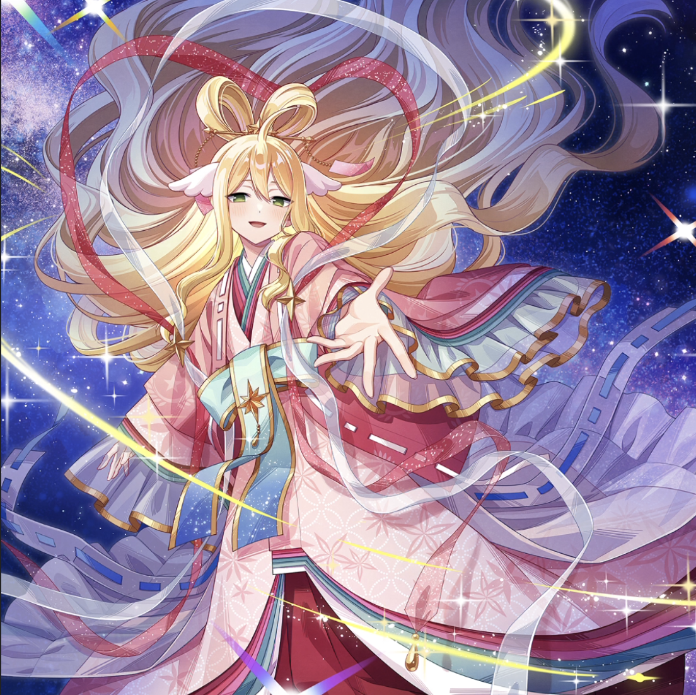

**Rarity:** UR

**Attribute:** 💚 Technique

**Class:** Ranged

**Identity:** Mavis Vermillion

**Normal attack range:** Ranged

**Signature lacrima:** [[lacrimas/starry-reunion-mavis-lacrima-2588041c|✨ Starry Reunion Mavis Lacrima]]

## Game text

### 🗡️ Normal Skill (Ranged)

Deals damage equal to 150% of ATK to the target. After the attack hits, has a 30% chance to inflict &#91;High&#93; Bleed on the target for 3 sec.

### 🗡️ Special Skill – Fairy Milky Way

When a critical hit occurs, grants all Technique allies &#91;Top&#93; ATK Increase and &#91;Top&#93; Criticla Damage Increase for 5 sec.

### 💥 Ultimate - Wish-Granting Tanzaku

Deals damage equal to 850% of ATK to enemies within the target area every 9 sec. After the attack hits, inflicts &#91;Top&#93; Bleed and &#91;Top&#93; Critical Resistance Decrease on each target for 5 sec.

## Effect applications

### High Bleed
| Property | Value |
| --- | --- |
| Family | Bleed |
| Target | Single Enemy |
| Activation | Normal SKill Hit |
| Chance | 30% |
| Duration | 3 sec |
| Value | 35 Percent of ATK per sec |
| Source skill | Normal Attack |

Deals damage equal to 150% of ATK to the target. After the attack hits, has a 30% chance to inflict &#91;High&#93; Bleed on the target for 3 sec.

### Top ATK Increase
| Property | Value |
| --- | --- |
| Family | ATK |
| Target | Technique Allies |
| Activation | Critical Hit |
| Duration | 5 sec |
| Value | 30 Percent |
| Source skill | Special Skill |

When a critical hit occurs, grants all Technique allies &#91;Top&#93; ATK Increase and &#91;Top&#93; Criticla Damage Increase for 5 sec.

### Top Critical Damage Increase
| Property | Value |
| --- | --- |
| Family | Critical Damage |
| Target | Technique Allies |
| Activation | Critical Hit |
| Duration | 5 sec |
| Value | 50 Percent |
| Source skill | Special Skill |

When a critical hit occurs, grants all Technique allies &#91;Top&#93; ATK Increase and &#91;Top&#93; Criticla Damage Increase for 5 sec.

### Top Critical Resistance Decrease
| Property | Value |
| --- | --- |
| Family | Critical Resistance |
| Target | Each Target Hit |
| Activation | Every 9 sec, After Attack Hits |
| Duration | 5 sec |
| Value | 20 Percent |
| Source skill | Ultimate |

Deals damage equal to 850% of ATK to enemies within the target area every 9 sec. After the attack hits, inflicts &#91;Top&#93; Bleed and &#91;Top&#93; Critical Resistance Decrease on each target for 5 sec.

### Top Bleed
| Property | Value |
| --- | --- |
| Family | Bleed |
| Target | Each Target Hit |
| Activation | Every 9 sec, After Attack Hits |
| Duration | 5 sec |
| Value | 40 Percent of ATK per sec |
| Source skill | Ultimate |

Deals damage equal to 850% of ATK to enemies within the target area every 9 sec. After the attack hits, inflicts &#91;Top&#93; Bleed and &#91;Top&#93; Critical Resistance Decrease on each target for 5 sec.

Unspecified values remain unknown. Text is transcribed from game records; localization and entry errors may remain.
