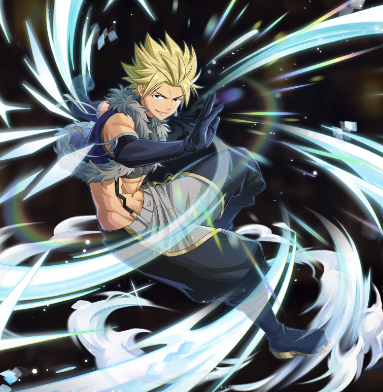

**Rarity:** UR

**Attribute:** ❤️ Brave

**Class:** Ranged

**Identity:** Sting Eucliffe

**Normal attack range:** Ranged

**Signature lacrima:** [[lacrimas/sting-lacrima-58dec98f|✨ Sting Lacrima]]

## Game text

### 🗡️ Normal Skill - Normal Attack (Ranged)

Deals 140% ATK damage to the target.

### 🗡️ Special Skill - White Drive

After a normal skill hits, there is a 20% chance to grant yourself for 5 sec &#91;Top&#93; Critical Rate Increase.

### 💥 Ultimate - Holy Nova

Every 9 sec, deal damage equal to 700% of ATK to enemies within the target area.

## Effect applications

### Top Critical Rate Increase
| Property | Value |
| --- | --- |
| Family | Critical Rate |
| Target | Self |
| Activation | Normal SKill Hit |
| Chance | 20% |
| Duration | 5 sec |
| Value | 20 Percent |
| Source skill | Special Skill |

After a normal skill hits, there is a 20% chance to grant yourself for 5 sec &#91;Top&#93; Critical Rate Increase.

Unspecified values remain unknown. Text is transcribed from game records; localization and entry errors may remain.
