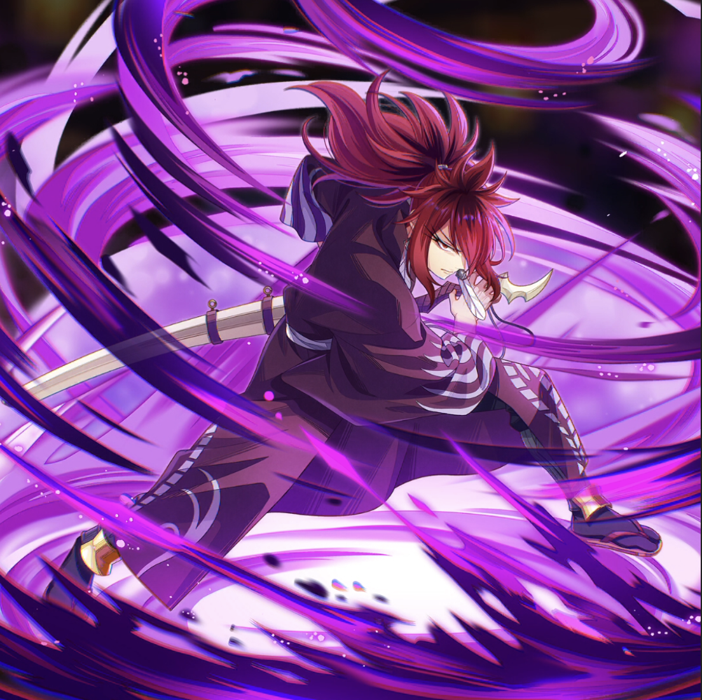

**Rarity:** UR

**Attribute:** 💚 Technique

**Class:** Melee

**Identity:** Suzaku

**Signature lacrima:** [[lacrimas/suzaku-lacrima-c66b5aa7|✨ Suzaku Lacrima]]

## Game text

### 🗡️ Normal Skill

Deals damage equal to 190% of ATK to the target. After hitting, has a 30% chance to inflict &#91;Top&#93; Bleed on the target for 3 sec.

### 🗡️ Special Skill - Kurnugi Style Sword Drawing Art

Constantly grants self &#91;Top&#93; ATK Increase, &#91;Top&#93; Critical Damage Increase, and &#91;Top&#93; Accuracy Increase.

### 💥 Ultimate – Underworld Black Purgatory Slash

Every 9 sec, deals damage equal to 1050% of ATK to enemies within range. After the attack hits, inflicts &#91;Top&#93; Bleed on each target for 5 sec, with a 30% chance to inflict &#91;Top&#93; Burn for 5 sec.

## Effect applications

### Top Bleed
| Property | Value |
| --- | --- |
| Family | Bleed |
| Target | Single Enemy |
| Activation | Normal SKill Hit |
| Chance | 30% |
| Duration | 3 sec |
| Value | 40 Percent of ATK per sec |
| Source skill | Normal Attack |

Deals damage equal to 190% of ATK to the target. After hitting, has a 30% chance to inflict &#91;Top&#93; Bleed on the target for 3 sec.

### Top ATK Increase
| Property | Value |
| --- | --- |
| Family | ATK |
| Target | Self |
| Activation | Constant |
| Value | 30 Percent |
| Source skill | Special Skill |

Constantly grants self &#91;Top&#93; ATK Increase, &#91;Top&#93; Critical Damage Increase, and &#91;Top&#93; Accuracy Increase.

### Top Critical Damage Increase
| Property | Value |
| --- | --- |
| Family | Critical Damage |
| Target | Self |
| Activation | Constant |
| Value | 50 Percent |
| Source skill | Special Skill |

Constantly grants self &#91;Top&#93; ATK Increase, &#91;Top&#93; Critical Damage Increase, and &#91;Top&#93; Accuracy Increase.

### Top Accuracy Increase
| Property | Value |
| --- | --- |
| Family | Accuracy |
| Target | Self |
| Activation | Constant |
| Value | 20 Percent |
| Source skill | Special Skill |

Constantly grants self &#91;Top&#93; ATK Increase, &#91;Top&#93; Critical Damage Increase, and &#91;Top&#93; Accuracy Increase.

### Top Bleed
| Property | Value |
| --- | --- |
| Family | Bleed |
| Target | Each Target Hit |
| Activation | Every 9 sec, After Attack Hits |
| Duration | 5 sec |
| Value | 40 Percent of ATK per sec |
| Source skill | Ultimate |

Every 9 sec, deals damage equal to 1050% of ATK to enemies within range. After the attack hits, inflicts &#91;Top&#93; Bleed on each target for 5 sec, with a 30% chance to inflict &#91;Top&#93; Burn for 5 sec.

### Top Burn
| Property | Value |
| --- | --- |
| Family | Burn |
| Target | Each Target Hit |
| Activation | Every 9 sec, After Attack Hits |
| Chance | 30% |
| Duration | 5 sec |
| Value | 30 Percent of ATK per sec |
| Source skill | Ultimate |

Every 9 sec, deals damage equal to 1050% of ATK to enemies within range. After the attack hits, inflicts &#91;Top&#93; Bleed on each target for 5 sec, with a 30% chance to inflict &#91;Top&#93; Burn for 5 sec.

Unspecified values remain unknown. Text is transcribed from game records; localization and entry errors may remain.
