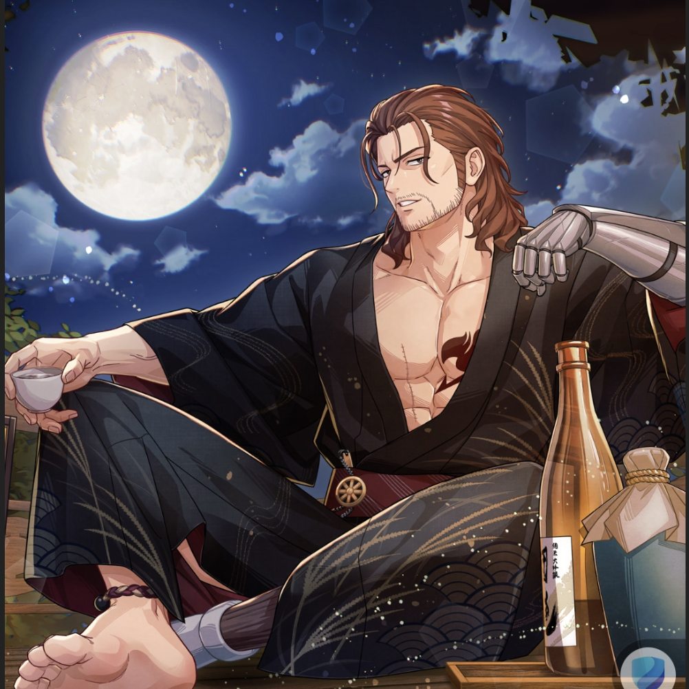

**Rarity:** UR

**Attribute:** 💙 Mind

**Class:** Disrupt

**Identity:** Gildarts Clive

**Normal attack range:** Ranged

**Signature lacrima:** [[lacrimas/swayed-by-the-evening-breeze-gildarts-lacrima-925e3f2a|✨ Swayed by the Evening Breeze Gildarts Lacrima]]

## Game text

### 🗡️ Normal Skill (Ranged)

Deals damage equal to 130% of ATK to the target. After the attack hits, has a 30% chance to inflict &#91;High&#93; Paralysis and Healing Block on the target for 3 sec.

### 🗡️ Special Skill – Sake Through the Night

Every 7 sec, inflicts &#91;High&#93; Evasion Decrease, &#91;High&#93; Critical Defense Decrease, and &#91;High&#93; Critical Resistance Decrease on all enemies for 7 sec.

### 💥 Ultimate – Moon-Shattering Impact 

Every 10 sec, deals damage equal to 900% of ATK to targets within range. Increases damge by 10% for each debuff/status effect on all enemies (up to 500%). After the attack hits, has a 30% chance to inflict Bind and &#91;Top&#93; Paralysis on each target for 7 sec.

## Effect applications

### High Paralysis
| Property | Value |
| --- | --- |
| Family | Paralysis |
| Target | Single Enemy |
| Activation | Normal SKill Hit |
| Chance | 30% |
| Duration | 3 sec |
| Value | 25 Percent of ATK per sec |
| Source skill | Normal Attack |

Deals damage equal to 130% of ATK to the target. After the attack hits, has a 30% chance to inflict &#91;High&#93; Paralysis and Healing Block on the target for 3 sec.

### Heal Block
| Property | Value |
| --- | --- |
| Family | Heal Block |
| Target | Single Enemy |
| Activation | Normal SKill Hit |
| Chance | 30% |
| Duration | 3 sec |
| Source skill | Normal Attack |

Deals damage equal to 130% of ATK to the target. After the attack hits, has a 30% chance to inflict &#91;High&#93; Paralysis and Healing Block on the target for 3 sec.

### High Evasion Decrease
| Property | Value |
| --- | --- |
| Family | Evasion |
| Target | All Enemies |
| Activation | Every 7 sec |
| Duration | 7 sec |
| Value | 15 Percent |
| Source skill | Special Skill |

Every 7 sec, inflicts &#91;High&#93; Evasion Decrease, &#91;High&#93; Critical Defense Decrease, and &#91;High&#93; Critical Resistance Decrease on all enemies for 7 sec.

### High Critical Defense Decrease
| Property | Value |
| --- | --- |
| Family | Critical Defense |
| Target | All Enemies |
| Activation | Every 7 sec |
| Duration | 7 sec |
| Value | 40 Percent |
| Source skill | Special Skill |

Every 7 sec, inflicts &#91;High&#93; Evasion Decrease, &#91;High&#93; Critical Defense Decrease, and &#91;High&#93; Critical Resistance Decrease on all enemies for 7 sec.

### High Critical Resistance Decrease
| Property | Value |
| --- | --- |
| Family | Critical Resistance |
| Target | All Enemies |
| Activation | Every 7 sec |
| Duration | 7 sec |
| Value | 15 Percent |
| Source skill | Special Skill |

Every 7 sec, inflicts &#91;High&#93; Evasion Decrease, &#91;High&#93; Critical Defense Decrease, and &#91;High&#93; Critical Resistance Decrease on all enemies for 7 sec.

### Bind
| Property | Value |
| --- | --- |
| Family | Bind |
| Target | Each Target Hit |
| Activation | Every 10 sec, After Attack Hits |
| Chance | 30% |
| Duration | 7 sec |
| Source skill | Ultimate |

Every 10 sec, deals damage equal to 900% of ATK to targets within range. Increases damge by 10% for each debuff/status effect on all enemies (up to 500%). After the attack hits, has a 30% chance to inflict Bind and &#91;Top&#93; Paralysis on each target for 7 sec.

### Top Paralysis
| Property | Value |
| --- | --- |
| Family | Paralysis |
| Target | Each Target Hit |
| Activation | Every 10 sec, After Attack Hits |
| Chance | 30% |
| Duration | 7 sec |
| Value | 30 Percent of ATK per sec |
| Source skill | Ultimate |

Every 10 sec, deals damage equal to 900% of ATK to targets within range. Increases damge by 10% for each debuff/status effect on all enemies (up to 500%). After the attack hits, has a 30% chance to inflict Bind and &#91;Top&#93; Paralysis on each target for 7 sec.

Unspecified values remain unknown. Text is transcribed from game records; localization and entry errors may remain.
