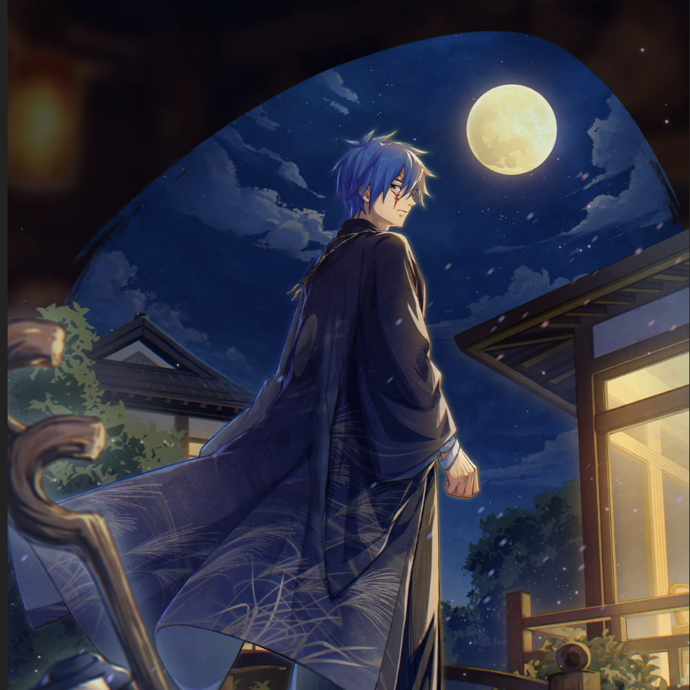

**Rarity:** UR

**Attribute:** 💛 Heart

**Class:** Ranged

**Identity:** Mystogan

**Normal attack range:** Ranged

**Signature lacrima:** [[lacrimas/swayed-by-the-evening-breeze-mystogan-lacrima-0270dd1b|✨ Swayed by the Evening Breeze Mystogan Lacrima]]

## Game text

### 🗡️ Normal Skill (Ranged)

Deals damage equal to 170% of ATK to the target, After the attack hits, has a 30% chance to inflict &#91;High&#93; Evasion Decrease and &#91;High&#93; Burn on the target for 3 sec.

### 🗡️ Special Skill – Moonlit Radiance

When a critical hit occurs, grants all Heart-type allies &#91;Top&#93; DEF Increase, &#91;Top&#93; Critical Defense Increase, and &#91;High&#93; Continuous Recovery for 5 sec.

### 💥 Ultimate – Moonlit Guidance

Every 10 sec, deals damage equal to 950% of ATK to enemies within the target area. After the attack hits, grants all allies &#91;Top&#93; ATK Increase and &#91;Top&#93; Shield for 5 sec. Extends the duration of these additional effects by 0.5 sec fro each Heart-type ally (max 3.5 sec). Also advances the current Ultimate Skill Gauge by 0.7 sec.

## Effect applications

### High Evasion Decrease
| Property | Value |
| --- | --- |
| Family | Evasion |
| Target | Single Enemy |
| Activation | Normal SKill Hit |
| Chance | 30% |
| Duration | 3 sec |
| Value | 15 Percent |
| Source skill | Normal Attack |

Deals damage equal to 170% of ATK to the target, After the attack hits, has a 30% chance to inflict &#91;High&#93; Evasion Decrease and &#91;High&#93; Burn on the target for 3 sec.

### High Burn
| Property | Value |
| --- | --- |
| Family | Burn |
| Target | Single Enemy |
| Activation | Normal SKill Hit |
| Chance | 30% |
| Duration | 3 sec |
| Value | 25 Percentage of Source ATK per second |
| Source skill | Normal Attack |

Deals damage equal to 170% of ATK to the target, After the attack hits, has a 30% chance to inflict &#91;High&#93; Evasion Decrease and &#91;High&#93; Burn on the target for 3 sec.

### Top DEF Increase
| Property | Value |
| --- | --- |
| Family | DEF |
| Target | Heart Allies |
| Activation | Critical Hit |
| Duration | 5 sec |
| Value | 30 Percent |
| Source skill | Special Skill |

When a critical hit occurs, grants all Heart-type allies &#91;Top&#93; DEF Increase, &#91;Top&#93; Critical Defense Increase, and &#91;High&#93; Continuous Recovery for 5 sec.

### Top Critical Defense Increase
| Property | Value |
| --- | --- |
| Family | Critical Defense |
| Target | Heart Allies |
| Activation | Critical Hit |
| Duration | 5 sec |
| Value | 50 Percent |
| Source skill | Special Skill |

When a critical hit occurs, grants all Heart-type allies &#91;Top&#93; DEF Increase, &#91;Top&#93; Critical Defense Increase, and &#91;High&#93; Continuous Recovery for 5 sec.

### High Continuous Heal
| Property | Value |
| --- | --- |
| Family | Heal |
| Target | Heart Allies |
| Activation | Critical Hit |
| Duration | 5 sec |
| Value | 100 Percent of ATK per sec |
| Source skill | Special Skill |

When a critical hit occurs, grants all Heart-type allies &#91;Top&#93; DEF Increase, &#91;Top&#93; Critical Defense Increase, and &#91;High&#93; Continuous Recovery for 5 sec.

### Top ATK Increase
| Property | Value |
| --- | --- |
| Family | ATK |
| Target | All Allies |
| Activation | Every 10 sec, After Attack Hits |
| Duration | 5 sec |
| Value | 30 Percent |
| Source skill | Ultimate |

Every 10 sec, deals damage equal to 950% of ATK to enemies within the target area. After the attack hits, grants all allies &#91;Top&#93; ATK Increase and &#91;Top&#93; Shield for 5 sec. Extends the duration of these additional effects by 0.5 sec fro each Heart-type ally (max 3.5 sec). Also advances the current Ultimate Skill Gauge by 0.7 sec.

### Top Shield
| Property | Value |
| --- | --- |
| Family | Shield |
| Target | All Allies |
| Activation | Every 10 sec, After Attack Hits |
| Duration | 5 sec |
| Value | 25 Percent of Max HP |
| Source skill | Ultimate |

Every 10 sec, deals damage equal to 950% of ATK to enemies within the target area. After the attack hits, grants all allies &#91;Top&#93; ATK Increase and &#91;Top&#93; Shield for 5 sec. Extends the duration of these additional effects by 0.5 sec fro each Heart-type ally (max 3.5 sec). Also advances the current Ultimate Skill Gauge by 0.7 sec.

### Advance Ultimate Skill Gauge
| Property | Value |
| --- | --- |
| Family | Ultimate Skill Gauge |
| Target | Current Ultimate Skill Gauge |
| Activation | Every 10 sec, After Attack Hits |
| Value | 0.7 Seconds |
| Source skill | Ultimate |

Every 10 sec, deals damage equal to 950% of ATK to enemies within the target area. After the attack hits, grants all allies &#91;Top&#93; ATK Increase and &#91;Top&#93; Shield for 5 sec. Extends the duration of these additional effects by 0.5 sec fro each Heart-type ally (max 3.5 sec). Also advances the current Ultimate Skill Gauge by 0.7 sec.

Unspecified values remain unknown. Text is transcribed from game records; localization and entry errors may remain.
