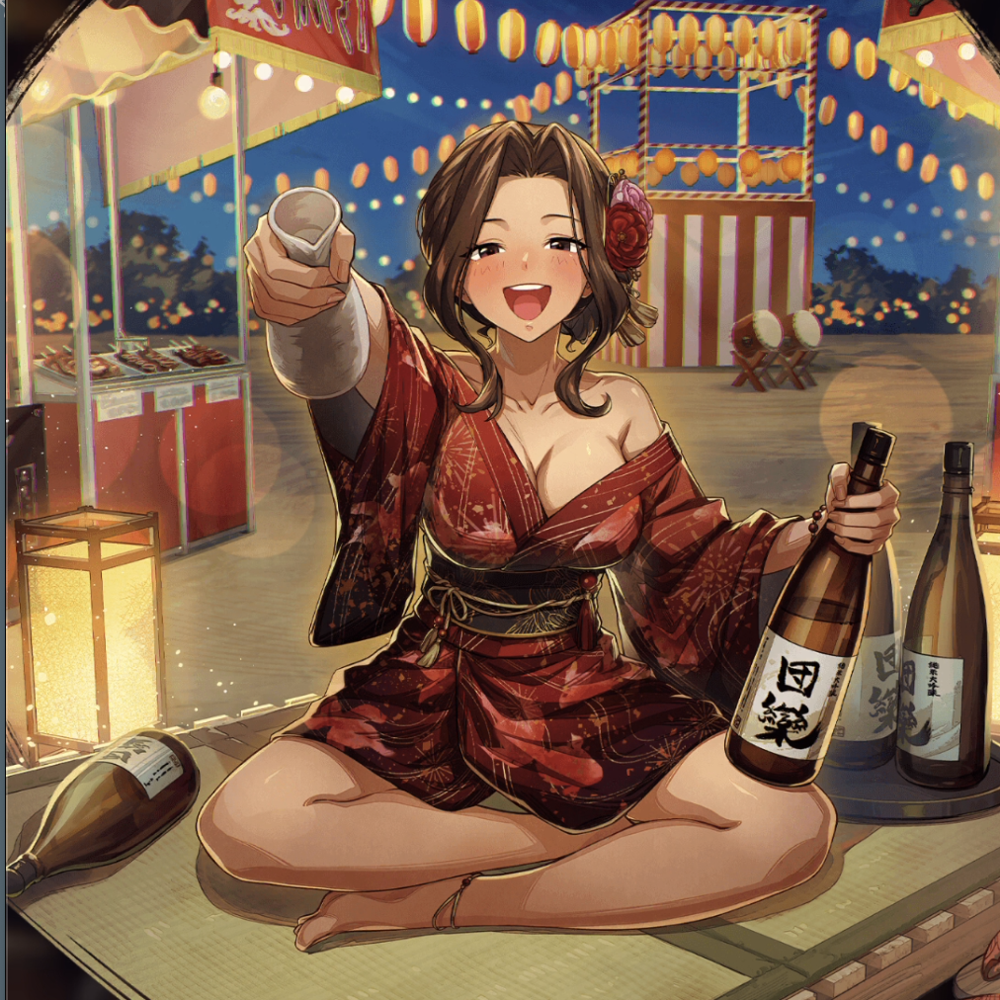

**Rarity:** UR

**Attribute:** 💛 Heart

**Class:** Melee

**Identity:** Cana Alberona

**Normal attack range:** Ranged

**Signature lacrima:** [[lacrimas/swaying-in-the-summer-night-cana-lacrima-2ce439d2|✨ Swaying in the Summer Night Cana Lacrima]]

## Game text

### 🗡️ Normal Skill (Ranged)

Deals damage equal to 190% of ATK to the target. After the attack hits, has a 30% chance to inflict the target with Silence, &#91;High&#93; ATK Decrease, and &#91;Low&#93; Accuracy Decrease for 3 sec.

### 🗡️ Special Skill – Let the Brawl Begin

After a normal skill hits, if an enemy within the target&#x27;s area is affected by Bleed or Silence, inflicts each enemy with &#91;Top&#93; DEF Decrease, &#91;Top&#93; Critical DEF Decrease, and &#91;Top&#93; Evasion Decrease for 5 sec.

### 💥 Ultimate – Summer Drunken Brawl

Every 10 sec, deals damage equal to 1000% of ATK to enemies within range. After the attack hits, deals additional damage equal to 50% of the user&#x27;s lost HP to the target, and inflicts &#91;Top&#93; ATK Decrease for 5 sec.

## Effect applications

### Silence
| Property | Value |
| --- | --- |
| Family | Silence |
| Target | Single Enemy |
| Activation | Normal SKill Hit |
| Chance | 30% |
| Duration | 3 sec |
| Source skill | Normal Attack |

Deals damage equal to 190% of ATK to the target. After the attack hits, has a 30% chance to inflict the target with Silence, &#91;High&#93; ATK Decrease, and &#91;Low&#93; Accuracy Decrease for 3 sec.

### High ATK Decrease
| Property | Value |
| --- | --- |
| Family | ATK |
| Target | Single Enemy |
| Activation | Normal SKill Hit |
| Chance | 30% |
| Duration | 3 sec |
| Value | 25 Percent |
| Source skill | Normal Attack |

After the attack hits, there is a 30% chance to inflict &#91;High&#93; ATK Decrease on the target for 3 sec

### Low Accuracy Decrease
| Property | Value |
| --- | --- |
| Family | Accuracy |
| Target | Single Enemy |
| Activation | Normal SKill Hit |
| Chance | 30% |
| Duration | 3 sec |
| Value | 5 Percent |
| Source skill | Normal Attack |

Deals damage equal to 190% of ATK to the target. After the attack hits, has a 30% chance to inflict the target with Silence, &#91;High&#93; ATK Decrease, and &#91;Low&#93; Accuracy Decrease for 3 sec.

### Top DEF Decrease
| Property | Value |
| --- | --- |
| Family | DEF |
| Target | Enemies in Target Area |
| Activation | Normal SKill Hit |
| Duration | 5 sec |
| Value | 30 Percent |
| Required effects | Bleed, Silence |
| Match rule | Any |
| Condition subject | Target |
| Evaluation timing | After Attack Hits |
| Required state | Present |
| Source skill | Special Skill |

After a normal skill hits, if an enemy within the target&#x27;s area is affected by Bleed or Silence, inflicts each enemy with &#91;Top&#93; DEF Decrease, &#91;Top&#93; Critical DEF Decrease, and &#91;Top&#93; Evasion Decrease for 5 sec.

### Top Critical Defense Decrease
| Property | Value |
| --- | --- |
| Family | Critical Defense |
| Target | Enemies in Target Area |
| Activation | Normal SKill Hit |
| Duration | 5 sec |
| Value | 50 Percent |
| Required effects | Silence, Bleed |
| Match rule | Any |
| Condition subject | Target |
| Evaluation timing | After Attack Hits |
| Required state | Present |
### Top Evasion Decrease
| Property | Value |
| --- | --- |
| Family | Evasion |
| Target | Enemies in Target Area |
| Activation | Normal SKill Hit |
| Duration | 5 sec |
| Value | 20 Percent |
| Required effects | Bleed, Silence |
| Match rule | Any |
| Condition subject | Target |
| Evaluation timing | After Attack Hits |
| Required state | Present |
| Source skill | Special Skill |

After a normal skill hits, if an enemy within the target&#x27;s area is affected by Bleed or Silence, inflicts each enemy with &#91;Top&#93; DEF Decrease, &#91;Top&#93; Critical DEF Decrease, and &#91;Top&#93; Evasion Decrease for 5 sec.

### Additional Damage
| Property | Value |
| --- | --- |
| Family | Damage |
| Target | Each Target Hit |
| Activation | Every 10 sec, After Attack Hits |
| Value | 50 Percent of HP Lost |
| Source skill | Ultimate |

Every 10 sec, deals damage equal to 1000% of ATK to enemies within range. After the attack hits, deals additional damage equal to 50% of the user&#x27;s lost HP to the target, and inflicts &#91;Top&#93; ATK Decrease for 5 sec.

### Top ATK Decrease
| Property | Value |
| --- | --- |
| Family | ATK |
| Target | Each Target Hit |
| Activation | Every 10 sec, After Attack Hits |
| Duration | 5 sec |
| Value | 30 Percent |
| Source skill | Ultimate |

Every 10 sec, deals damage equal to 1000% of ATK to enemies within range. After the attack hits, deals additional damage equal to 50% of the user&#x27;s lost HP to the target, and inflicts &#91;Top&#93; ATK Decrease for 5 sec.

Unspecified values remain unknown. Text is transcribed from game records; localization and entry errors may remain.
