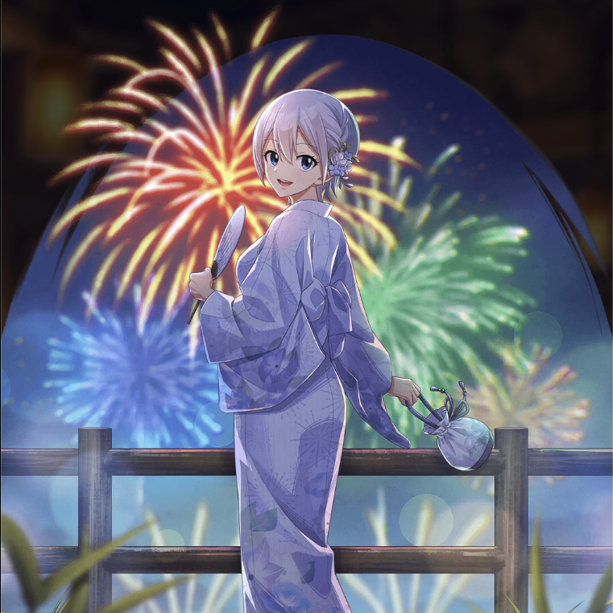

**Rarity:** UR

**Attribute:** 💚 Technique

**Class:** Heal

**Identity:** Lisanna Strauss

**Normal attack range:** Ranged

**Signature lacrima:** [[lacrimas/swaying-in-the-summer-night-lisanna-lacrima-cd4dcf70|✨ Swaying in the Summer Night Lisanna Lacrima]]

## Game text

### 🗡️ Normal Skill (Ranged)

Deals damage equal to 150% of ATK to the target. After the attack hits, restores the HP of the ally with the lowest HP by an amount equal to 130% of the user&#x27;s ATK.

### 🗡️ Special Skill – Giant Blossoms Blooming in the Night Sky

Every 5 sec, grants all allies &#91;Top&#93; ATK Increase, &#91;Top&#93; Critical Rate Increase, and &#91;Top&#93; Accuracy Increase for 5 sec.

### 💥 Ultimate – Firework Blessing

Every 11 sec, restores HP to all allies equal to 950% of the user&#x27;s ATK. Increases healing by 50% for each Technique ally (up to 350%). Also grants the target &#91;Top&#93; Continuous Heal, Action Block Barrier, and &#91;Top&#93; Critical Damage Increase for 5 sec, and removes all debuffs from all allies.

## Effect applications

### Heal
| Property | Value |
| --- | --- |
| Family | Heal |
| Target | Lowest HP Ally |
| Activation | Normal SKill Hit |
| Value | 130 Percent of own ATK |
| Source skill | Normal Attack |

Deals damage equal to 150% of ATK to the target. After the attack hits, restores the HP of the ally with the lowest HP by an amount equal to 130% of the user&#x27;s ATK.

### Top ATK Increase
| Property | Value |
| --- | --- |
| Family | ATK |
| Target | All Allies |
| Activation | Every 5 sec |
| Duration | 5 sec |
| Value | 30 Percent |
| Source skill | Special Skill |

Every 5 sec, grants all allies &#91;Top&#93; ATK Increase, &#91;Top&#93; Critical Rate Increase, and &#91;Top&#93; Accuracy Increase for 5 sec.

### Top Critical Rate Increase
| Property | Value |
| --- | --- |
| Family | Critical Rate |
| Target | All Allies |
| Activation | Every 5 sec |
| Duration | 5 sec |
| Value | 20 Percent |
| Source skill | Special Skill |

Every 5 sec, grants all allies &#91;Top&#93; ATK Increase, &#91;Top&#93; Critical Rate Increase, and &#91;Top&#93; Accuracy Increase for 5 sec.

### Top Accuracy Increase
| Property | Value |
| --- | --- |
| Family | Accuracy |
| Target | All Allies |
| Activation | Every 5 sec |
| Duration | 5 sec |
| Value | 20 Percent |
| Source skill | Special Skill |

Every 5 sec, grants all allies &#91;Top&#93; ATK Increase, &#91;Top&#93; Critical Rate Increase, and &#91;Top&#93; Accuracy Increase for 5 sec.

### Top Continuous Heal
| Property | Value |
| --- | --- |
| Family | Heal |
| Target | All Allies |
| Activation | Every 11 sec |
| Duration | 5 sec |
| Value | 120 Percent of ATK per sec |
| Source skill | Ultimate |

Every 11 sec, restores HP to all allies equal to 950% of the user&#x27;s ATK. Increases healing by 50% for each Technique ally (up to 350%). Also grants the target &#91;Top&#93; Continuous Heal, Action Block Barrier, and &#91;Top&#93; Critical Damage Increase for 5 sec, and removes all debuffs from all allies.

### Action Block Barrier
| Property | Value |
| --- | --- |
| Family | Action Block Barrier |
| Target | All Allies |
| Activation | Every 11 sec |
| Duration | 5 sec |
| Source skill | Ultimate |

Every 11 sec, restores HP to all allies equal to 950% of the user&#x27;s ATK. Increases healing by 50% for each Technique ally (up to 350%). Also grants the target &#91;Top&#93; Continuous Heal, Action Block Barrier, and &#91;Top&#93; Critical Damage Increase for 5 sec, and removes all debuffs from all allies.

### Top Critical Damage Increase
| Property | Value |
| --- | --- |
| Family | Critical Damage |
| Target | All Allies |
| Activation | Every 11 sec |
| Duration | 5 sec |
| Value | 50 Percent |
| Source skill | Ultimate |

Every 11 sec, restores HP to all allies equal to 950% of the user&#x27;s ATK. Increases healing by 50% for each Technique ally (up to 350%). Also grants the target &#91;Top&#93; Continuous Heal, Action Block Barrier, and &#91;Top&#93; Critical Damage Increase for 5 sec, and removes all debuffs from all allies.

### Remove All Debuffs
| Property | Value |
| --- | --- |
| Family | Cleanse |
| Target | All Allies |
| Activation | Every 11 sec |
| Source skill | Ultimate |

Every 11 sec, restores HP to all allies equal to 950% of the user&#x27;s ATK. Increases healing by 50% for each Technique ally (up to 350%). Also grants the target &#91;Top&#93; Continuous Heal, Action Block Barrier, and &#91;Top&#93; Critical Damage Increase for 5 sec, and removes all debuffs from all allies.

### Heal
| Property | Value |
| --- | --- |
| Family | Heal |
| Target | All Allies |
| Activation | Every 11 sec |
| Value | 950.0 Percent of Own ATK |
| Condition | Increases healing by 50% for each Technique Ally (up to 350%) |
| Source skill | Ultimate |

Every 11 sec, restores HP to all allies equal to 950% of the user&#x27;s ATK. Increases healing by 50% for each Technique ally (up to 350%). Also grants the target &#91;Top&#93; Continuous Heal, Action Block Barrier, and &#91;Top&#93; Critical Damage Increase for 5 sec, and removes all debuffs from all allies.

Unspecified values remain unknown. Text is transcribed from game records; localization and entry errors may remain.
