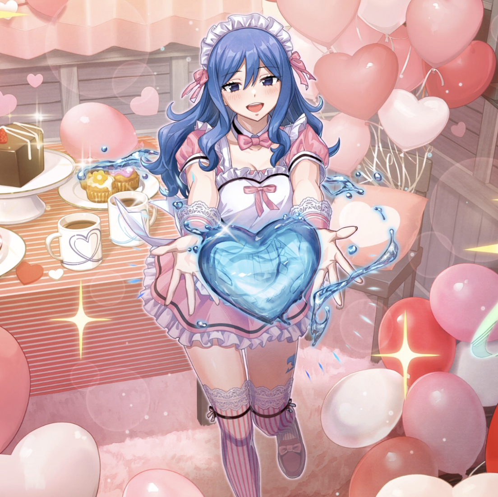

**Rarity:** UR

**Attribute:** 💚 Technique

**Class:** Heal

**Identity:** Juvia Lockser

**Normal attack range:** Ranged

**Signature lacrima:** [[lacrimas/sweet-gift-juvia-lacrima-3d8ab835|✨ Sweet Gift Juvia Lacrima]]

## Game text

### 🗡️ Normal Skill (Ranged)

Deals damage equal to 120% of ATK to the target. After the attack hits, restores HP to the ally with the lowest HP equal to 150% of your ATK.

### 🗡️ Special Skill – Heartful Gift

Every 7 seconds, grants Technique-type allies for 5 seconds: &#91;Top&#93; Critical Damage Increase and &#91;High&#93; Shield.

### 💥 Ultimate – Sweet Water Gift

Every 11 seconds, restores HP of all allies equal to 900% of your ATK. Additionally, grants the target for 5 seconds: &#91;Top&#93; ATK Increase, &#91;Top&#93; DEF Increase, &#91;Top&#93; Critical Defense Increase.

## Effect applications

### Heal
| Property | Value |
| --- | --- |
| Family | Heal |
| Target | Lowest HP Ally |
| Activation | Normal SKill Hit |
| Value | 150 Percent of own ATK |
| Source skill | Normal Attack |

Deals damage equal to 120% of ATK to the target. After the attack hits, restores HP to the ally with the lowest HP equal to 150% of your ATK.

### Top Critical Damage Increase
| Property | Value |
| --- | --- |
| Family | Critical Damage |
| Target | Technique Allies |
| Activation | Every 7 sec |
| Duration | 5 sec |
| Value | 50 Percent |
| Source skill | Special Skill |

Every 7 seconds, grants Technique-type allies for 5 seconds: &#91;Top&#93; Critical Damage Increase and &#91;High&#93; Shield.

### High Shield
| Property | Value |
| --- | --- |
| Family | Shield |
| Target | Technique Allies |
| Activation | Every 7 sec |
| Duration | 5 sec |
| Value | 20 Percent of Max HP |
| Source skill | Special Skill |

Every 7 seconds, grants Technique-type allies for 5 seconds: &#91;Top&#93; Critical Damage Increase and &#91;High&#93; Shield.

### Heal
| Property | Value |
| --- | --- |
| Family | Heal |
| Target | All Allies |
| Activation | Every 11 sec |
| Value | 900 Percent of own ATK |
| Source skill | Ultimate |

Every 11 seconds, restores HP of all allies equal to 900% of your ATK. Additionally, grants the target for 5 seconds: &#91;Top&#93; ATK Increase, &#91;Top&#93; DEF Increase, &#91;Top&#93; Critical Defense Increase.

### Top ATK Increase
| Property | Value |
| --- | --- |
| Family | ATK |
| Target | All Allies |
| Activation | Every 11 sec |
| Duration | 5 sec |
| Value | 30 Percent |
| Source skill | Ultimate |

Every 11 seconds, restores HP of all allies equal to 900% of your ATK. Additionally, grants the target for 5 seconds: &#91;Top&#93; ATK Increase, &#91;Top&#93; DEF Increase, &#91;Top&#93; Critical Defense Increase.

### Top DEF Increase
| Property | Value |
| --- | --- |
| Family | DEF |
| Target | All Allies |
| Activation | Every 11 sec |
| Duration | 5 sec |
| Value | 30 Percent |
| Source skill | Ultimate |

Every 11 seconds, restores HP of all allies equal to 900% of your ATK. Additionally, grants the target for 5 seconds: &#91;Top&#93; ATK Increase, &#91;Top&#93; DEF Increase, &#91;Top&#93; Critical Defense Increase.

### Top Critical Defense Increase
| Property | Value |
| --- | --- |
| Family | Critical Defense |
| Target | All Allies |
| Activation | Every 11 sec |
| Duration | 5 sec |
| Value | 50 Percent |
| Source skill | Ultimate |

Every 11 seconds, restores HP of all allies equal to 900% of your ATK. Additionally, grants the target for 5 seconds: &#91;Top&#93; ATK Increase, &#91;Top&#93; DEF Increase, &#91;Top&#93; Critical Defense Increase.

Unspecified values remain unknown. Text is transcribed from game records; localization and entry errors may remain.
