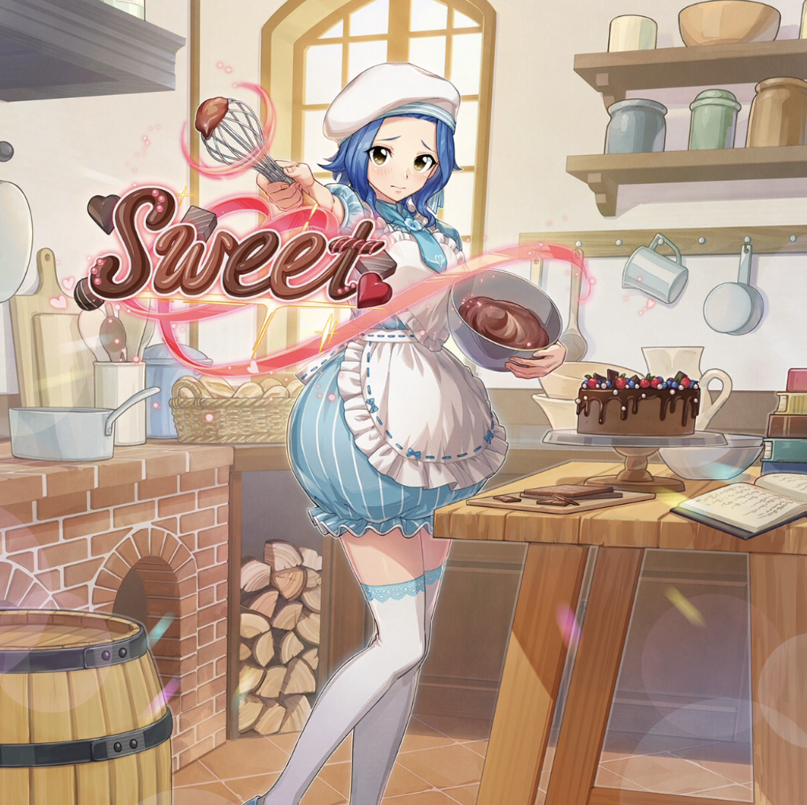

**Rarity:** UR

**Attribute:** 💛 Heart

**Class:** Ranged

**Identity:** Levy McGarden

**Normal attack range:** Ranged

**Signature lacrima:** [[lacrimas/sweet-gift-levy-lacrima-882dde3e|✨ Sweet Gift Levy Lacrima]]

## Game text

### 🗡️ Normal Skill (Ranged)

Deals Damage equal to 150% of ATK to the target. After the attack hits, has a 10% chance to inflict Silence on the target for 3 seconds.

### 🗡️ Special Skill – Sweet and Dangerous Love Letter

After a normal skill hits, if the target is affected by Silence, grants for 5 seconds: &#91;Top&#93; DEF Decrease and &#91;Top&#93; Critical Defense Decrease.

### 💥 Ultimate – 3D Text -Sweet-

Every 9 sec, deal damage equal to 650% of ATK within the target area. After the attack hits,  there is a 50% chance for 3 sec to inflict Silence and rewind the targets accumulated Ultimate Skill gauge by 0.7 seconds.

## Effect applications

### Silence
| Property | Value |
| --- | --- |
| Family | Silence |
| Target | Single Enemy |
| Activation | Normal SKill Hit |
| Chance | 10% |
| Duration | 3 sec |
| Source skill | Normal Attack |

Deals Damage equal to 150% of ATK to the target. After the attack hits, has a 10% chance to inflict Silence on the target for 3 seconds.

### Top DEF Decrease
| Property | Value |
| --- | --- |
| Family | DEF |
| Target | Single Enemy |
| Activation | Normal SKill Hit |
| Duration | 5 sec |
| Value | 30 Percent |
| Required effects | Silence |
| Match rule | Any |
| Condition subject | Target |
| Evaluation timing | After Attack Hits |
| Required state | Present |
### Top Critical Defense Decrease
| Property | Value |
| --- | --- |
| Family | Critical Defense |
| Target | Single Enemy |
| Activation | Normal SKill Hit |
| Duration | 5 sec |
| Value | 50 Percent |
| Required effects | Silence |
| Match rule | Any |
| Condition subject | Target |
| Evaluation timing | After Attack Hits |
| Required state | Present |
### Silence
| Property | Value |
| --- | --- |
| Family | Silence |
| Target | Each Target Hit |
| Activation | Every 9 sec, After Attack Hits |
| Chance | 50% |
| Duration | 3 sec |
| Source skill | Ultimate |

Every 9 sec, deal damage equal to 650% of ATK within the target area. After the attack hits,  there is a 50% chance for 3 sec to inflict Silence and rewind the targets accumulated Ultimate Skill gauge by 0.7 seconds.

### Push Back Ultimate Skill Gauge
| Property | Value |
| --- | --- |
| Family | Ultimate Skill Gauge |
| Target | Each Target Hit |
| Activation | Every 9 sec, After Attack Hits |
| Chance | 50% |
| Value | 0.7 Seconds |
| Source skill | Ultimate |

Every 9 sec, deal damage equal to 650% of ATK within the target area. After the attack hits,  there is a 50% chance for 3 sec to inflict Silence and rewind the targets accumulated Ultimate Skill gauge by 0.7 seconds.

Unspecified values remain unknown. Text is transcribed from game records; localization and entry errors may remain.
