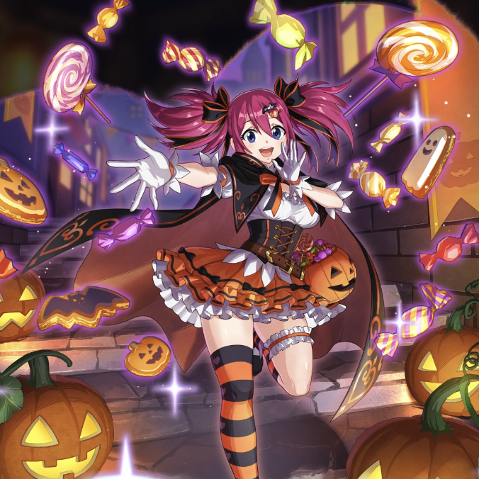

**Rarity:** UR

**Attribute:** 💙 Mind

**Class:** Melee

**Identity:** Sherria Blendy

**Signature lacrima:** [[lacrimas/twin-moon-halloween-sherria-lacrima-bd88b8fb|✨ Twin Moon Halloween Sherria Lacrima]]

## Game text

### 🗡️ Normal Skill

Deals 190% ATK damage to the target. After the attack hits, has a 30% chance to restore own HP by 600% of ATK and grants Critical Shield for 3 sec.

### 🗡️ Special Skill – Treat For You!

Every 5 sec, grants all Intelligence-type allies &#91;Top&#93; ATK Increase and &#91;Top&#93; Critical Rate Increase, &#91;Top&#93; Accuracy Increase, &#91;High&#93; Continuous Healing for 5 sec.

### 💥 Ultimate – Divine Feast of Sweets

Every 8 sec, deals 1050% ATK damage to all enemies. After the attack hits, has a 50% chance per target to inflict Bind and &#91;Top&#93; DEF Decrease for 5 sec, and removes all buffs from the target.

## Effect applications

### Heal
| Property | Value |
| --- | --- |
| Family | Heal |
| Target | Self |
| Activation | Normal SKill Hit |
| Chance | 30% |
| Value | 600 Percent of own ATK |
| Source skill | Normal Attack |

Deals 190% ATK damage to the target. After the attack hits, has a 30% chance to restore own HP by 600% of ATK and grants Critical Shield for 3 sec.

### Critical Shield
| Property | Value |
| --- | --- |
| Family | Critical Shield |
| Target | Self |
| Activation | Normal SKill Hit |
| Chance | 30% |
| Duration | 3 sec |
| Source skill | Normal Attack |

Deals 190% ATK damage to the target. After the attack hits, has a 30% chance to restore own HP by 600% of ATK and grants Critical Shield for 3 sec.

### Top ATK Increase
| Property | Value |
| --- | --- |
| Family | ATK |
| Target | Mind Allies |
| Activation | Every 5 sec |
| Duration | 5 sec |
| Value | 30 Percent |
| Source skill | Special Skill |

Every 5 sec, grants all Intelligence-type allies &#91;Top&#93; ATK Increase and &#91;Top&#93; Critical Rate Increase, &#91;Top&#93; Accuracy Increase, &#91;High&#93; Continuous Healing for 5 sec.

### Top Critical Rate Increase
| Property | Value |
| --- | --- |
| Family | Critical Rate |
| Target | Mind Allies |
| Activation | Every 5 sec |
| Duration | 5 sec |
| Value | 20 Percent |
| Source skill | Special Skill |

Every 5 sec, grants all Intelligence-type allies &#91;Top&#93; ATK Increase and &#91;Top&#93; Critical Rate Increase, &#91;Top&#93; Accuracy Increase, &#91;High&#93; Continuous Healing for 5 sec.

### Top Accuracy Increase
| Property | Value |
| --- | --- |
| Family | Accuracy |
| Target | Mind Allies |
| Activation | Every 5 sec |
| Duration | 5 sec |
| Value | 20 Percent |
| Source skill | Special Skill |

Every 5 sec, grants all Intelligence-type allies &#91;Top&#93; ATK Increase and &#91;Top&#93; Critical Rate Increase, &#91;Top&#93; Accuracy Increase, &#91;High&#93; Continuous Healing for 5 sec.

### High Continuous Heal
| Property | Value |
| --- | --- |
| Family | Heal |
| Target | Mind Allies |
| Activation | Every 5 sec |
| Duration | 5 sec |
| Value | 100 Percent of ATK per sec |
### Bind
| Property | Value |
| --- | --- |
| Family | Bind |
| Target | Each Target Hit |
| Activation | Every 8 sec, After Attack Hits |
| Chance | 50% |
| Duration | 5 sec |
| Source skill | Ultimate |

Every 8 sec, deals 1050% ATK damage to all enemies. After the attack hits, has a 50% chance per target to inflict Bind and &#91;Top&#93; DEF Decrease for 5 sec, and removes all buffs from the target.

### Top DEF Decrease
| Property | Value |
| --- | --- |
| Family | DEF |
| Target | Each Target Hit |
| Activation | Every 8 sec, After Attack Hits |
| Chance | 50% |
| Duration | 5 sec |
| Value | 30 Percent |
| Source skill | Ultimate |

Every 8 sec, deals 1050% ATK damage to all enemies. After the attack hits, has a 50% chance per target to inflict Bind and &#91;Top&#93; DEF Decrease for 5 sec, and removes all buffs from the target.

### Removes All Buffs
| Property | Value |
| --- | --- |
| Family | Cleanse |
| Target | Each Target Hit |
| Activation | Every 8 sec, After Attack Hits |
| Chance | 50% |
| Source skill | Ultimate |

Every 8 sec, deals 1050% ATK damage to all enemies. After the attack hits, has a 50% chance per target to inflict Bind and &#91;Top&#93; DEF Decrease for 5 sec, and removes all buffs from the target.

Unspecified values remain unknown. Text is transcribed from game records; localization and entry errors may remain.
