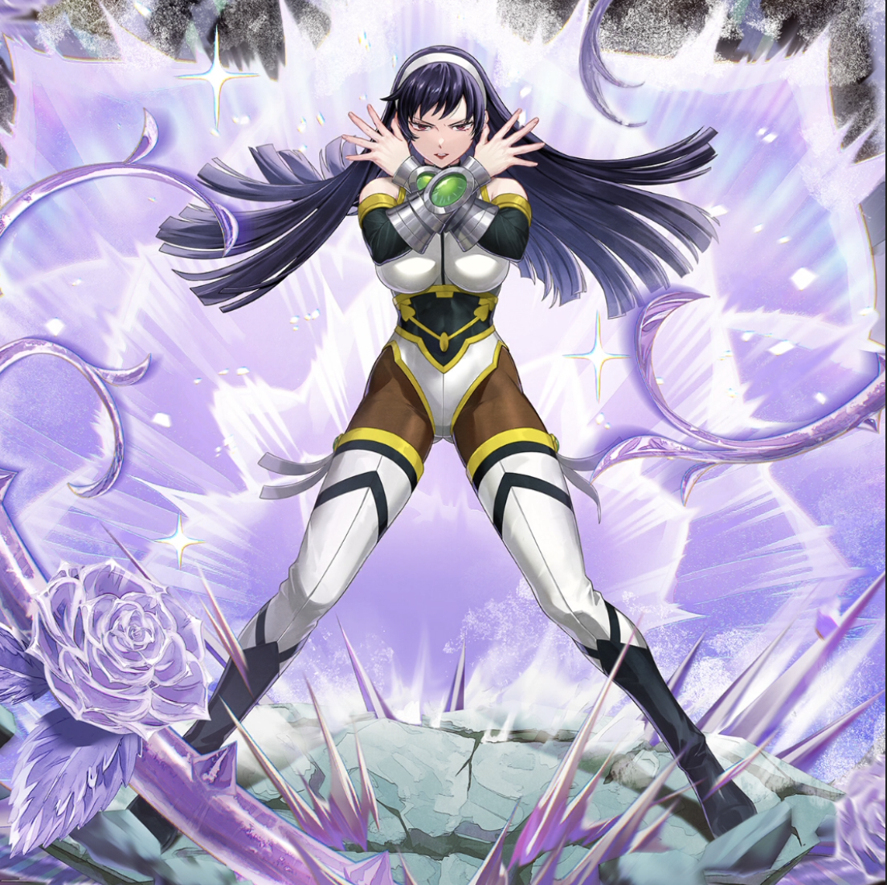

**Rarity:** UR

**Attribute:** ❤️ Brave

**Class:** Ranged

**Identity:** Ultear Milkovich

**Normal attack range:** Ranged

**Signature lacrima:** [[lacrimas/ultear-grimoire-heart-lacrima-f5e1fb05|✨ Ultear -Grimoire Heart- Lacrima]]

## Game text

### 🗡️ Normal Skill (Ranged)

Deals damage equal to 180% of ATK to the target. When a critical Hit occurs, grants all Brave allies &#91;High&#93; ATK Increase and &#91;High&#93; Critical Damage Increase for 3 sec.

### 🗡️ Special Skill – Chain of Time

If enemies within the target area are affected by Freeze after a normal skill hits, inflicts &#91;Top&#93; DEF Decrease, &#91;Top&#93; Critical Resistance Decrease, and Silence on each enemy for 5 sec.

### 💥 Ultimate – Ice-Make: Rosen Krone

Deals damage equal to 950% of ATK to all enemies every 10 sec. After a successful hit, has a 30% chance to inflict &#91;Top&#93; Freeze on each target for 5 sec. Extends the duration of this additional effect by 0.5 sec for each Brave ally (up to 3 sec).

## Effect applications

### High ATK Increase
| Property | Value |
| --- | --- |
| Family | ATK |
| Target | Brave Allies |
| Activation | Critical Hit |
| Duration | 3 sec |
| Value | 25 Percent |
| Source skill | Normal Attack |

Deals damage equal to 180% of ATK to the target. When a critical Hit occurs, grants all Brave allies &#91;High&#93; ATK Increase and &#91;High&#93; Critical Damage Increase for 3 sec.

### High Critical Damage Increase
| Property | Value |
| --- | --- |
| Family | Critical Damage |
| Target | Brave Allies |
| Activation | Critical Hit |
| Duration | 3 sec |
| Value | 40 Percent |
| Source skill | Normal Attack |

Deals damage equal to 180% of ATK to the target. When a critical Hit occurs, grants all Brave allies &#91;High&#93; ATK Increase and &#91;High&#93; Critical Damage Increase for 3 sec.

### Top DEF Decrease
| Property | Value |
| --- | --- |
| Family | DEF |
| Target | Enemies in Target Area |
| Activation | Normal SKill Hit |
| Duration | 5 sec |
| Value | 30 Percent |
| Required effects | Freeze |
| Match rule | Any |
| Condition subject | Target |
| Evaluation timing | After Attack Hits |
| Required state | Present |
| Source skill | Special Skill |

If enemies within the target area are affected by Freeze after a normal skill hits, inflicts &#91;Top&#93; DEF Decrease, &#91;Top&#93; Critical Resistance Decrease, and Silence on each enemy for 5 sec.

### Top Critical Resistance Decrease
| Property | Value |
| --- | --- |
| Family | Critical Resistance |
| Target | Enemies in Target Area |
| Activation | Normal SKill Hit |
| Duration | 5 sec |
| Value | 20 Percent |
| Required effects | Freeze |
| Match rule | Any |
| Condition subject | Target |
| Evaluation timing | After Attack Hits |
| Required state | Present |
| Source skill | Special Skill |

If enemies within the target area are affected by Freeze after a normal skill hits, inflicts &#91;Top&#93; DEF Decrease, &#91;Top&#93; Critical Resistance Decrease, and Silence on each enemy for 5 sec.

### Silence
| Property | Value |
| --- | --- |
| Family | Silence |
| Target | Enemies in Target Area |
| Activation | Normal SKill Hit |
| Duration | 5 sec |
| Required effects | Freeze |
| Match rule | Any |
| Condition subject | Target |
| Evaluation timing | After Attack Hits |
| Required state | Present |
| Source skill | Special Skill |

If enemies within the target area are affected by Freeze after a normal skill hits, inflicts &#91;Top&#93; DEF Decrease, &#91;Top&#93; Critical Resistance Decrease, and Silence on each enemy for 5 sec.

### Top Freeze
| Property | Value |
| --- | --- |
| Family | Freeze |
| Target | Each Target Hit |
| Activation | Every 10 sec |
| Chance | 30% |
| Duration | 5 sec |
| Source skill | Ultimate |

Extends the duration of this additional effect by 0.5 sec for each Brave ally (up to 3 sec)

Unspecified values remain unknown. Text is transcribed from game records; localization and entry errors may remain.
