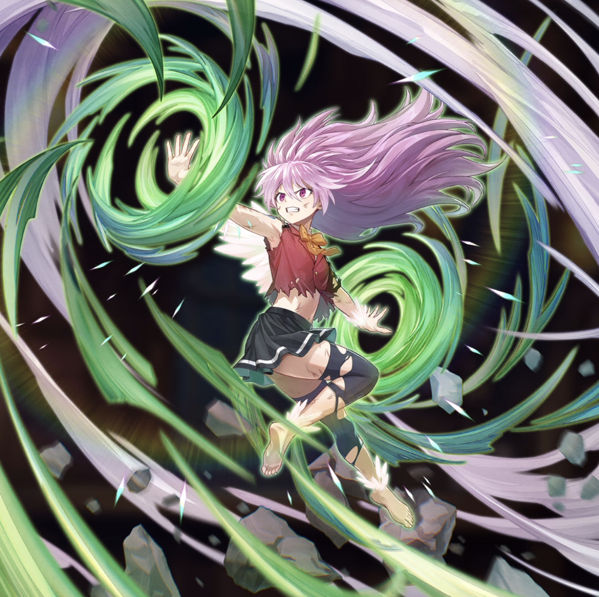

**Rarity:** UR

**Attribute:** 💚 Technique

**Class:** Ranged

**Identity:** Wendy Marvell

**Normal attack range:** Ranged

**Signature lacrima:** [[lacrimas/wendy-dragon-force-lacrima-3cd30ee4|✨ Wendy -Dragon Force- Lacrima]]

## Game text

### 🗡️ Normal Skill (Ranged)

Deals 160% ATK damage to the target. After the attack hits, there is a 30% chance to grant yourself for 3s &#91;High&#93; Continuous Heal.

### 🗡️ Special Skill – Sky Dragon&#x27;s Strike

After a normal skill hits, if enemies within the target&#x27;s range are affected by Burn, apply to each enemy for 5s &#91;Top&#93; Def Decrease, &#91;Top&#93; Critical Defense Decrease, and &#91;Top&#93; Evasion Decrease.

### 💥 Ultimate - Dragon Slayer&#x27;s Secret Art Shattering Light: Sky Drill

Deals 800% ATK damage to all enemies every 11s. After the attack hits, there is a 30% chance to apply for 5s to each target: &#91;Top&#93; Burn and Heal Block.

## Effect applications

### High Continuous Heal
| Property | Value |
| --- | --- |
| Family | Heal |
| Target | Self |
| Activation | Normal SKill Hit |
| Chance | 30% |
| Duration | 3 sec |
| Value | 100 Percent of ATK per sec |
| Source skill | Normal Attack |

Deals 160% ATK damage to the target. After the attack hits, there is a 30% chance to grant yourself for 3s &#91;High&#93; Continuous Heal.

### Top DEF Decrease
| Property | Value |
| --- | --- |
| Family | DEF |
| Target | Enemies in Target Area |
| Activation | Normal SKill Hit |
| Duration | 5 sec |
| Value | 30 Percent |
| Required effects | Burn |
| Match rule | Any |
| Condition subject | Target |
| Evaluation timing | After Attack Hits |
| Required state | Present |
| Source skill | Special Skill |

After a normal skill hits, if enemies within the target&#x27;s range are affected by Burn, apply to each enemy for 5s &#91;Top&#93; Def Decrease, &#91;Top&#93; Critical Defense Decrease, and &#91;Top&#93; Evasion Decrease.

### Top Critical Defense Decrease
| Property | Value |
| --- | --- |
| Family | Critical Defense |
| Target | Enemies in Target Area |
| Activation | Normal SKill Hit |
| Duration | 5 sec |
| Value | 50 Percent |
| Required effects | Burn |
| Match rule | Any |
| Condition subject | Target |
| Evaluation timing | After Attack Hits |
| Required state | Present |
### Top Evasion Decrease
| Property | Value |
| --- | --- |
| Family | Evasion |
| Target | Enemies in Target Area |
| Activation | Normal SKill Hit |
| Duration | 5 sec |
| Value | 20 Percent |
| Required effects | Burn |
| Match rule | Any |
| Condition subject | Target |
| Evaluation timing | After Attack Hits |
| Required state | Present |
| Source skill | Special Skill |

After a normal skill hits, if enemies within the target&#x27;s range are affected by Burn, apply to each enemy for 5s &#91;Top&#93; Def Decrease, &#91;Top&#93; Critical Defense Decrease, and &#91;Top&#93; Evasion Decrease.

### Top Burn
| Property | Value |
| --- | --- |
| Family | Burn |
| Target | Each Target Hit |
| Activation | Every 11 sec, After Attack Hits |
| Chance | 30% |
| Duration | 5 sec |
| Value | 30 Percent of ATK per sec |
| Source skill | Ultimate |

Deals 800% ATK damage to all enemies every 11s. After the attack hits, there is a 30% chance to apply for 5s to each target: &#91;Top&#93; Burn and Heal Block.

### Heal Block
| Property | Value |
| --- | --- |
| Family | Heal Block |
| Target | Each Target Hit |
| Activation | Every 11 sec, After Attack Hits |
| Chance | 30% |
| Duration | 5 sec |
| Source skill | Ultimate |

Deals 800% ATK damage to all enemies every 11s. After the attack hits, there is a 30% chance to apply for 5s to each target: &#91;Top&#93; Burn and Heal Block.

Unspecified values remain unknown. Text is transcribed from game records; localization and entry errors may remain.
