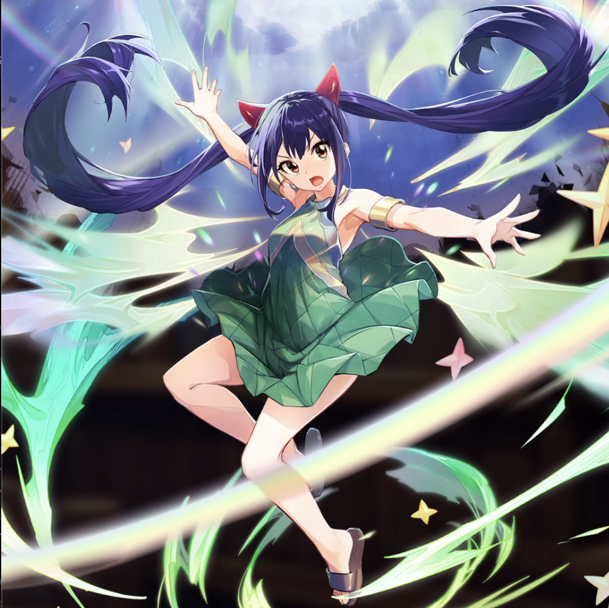

**Rarity:** UR

**Attribute:** 💙 Mind

**Class:** Heal

**Identity:** Wendy Marvell

**Normal attack range:** Ranged

**Signature lacrima:** [[lacrimas/wendy-lacrima-ddf7004e|✨ Wendy Lacrima]]

## Game text

### Normal Attack (Ranged)

Deals 120% ATK damage to the target.  After hitting, heals the ally with the lowest HP for 140% of your ATK.

### Special Skill – Knights of God

After a normal skill hits, there is a 10% chance to grant allies for 7 sec &#91;Top&#93; ATK Increase and &#91;Top&#93; Critical Rate Increase, and advance the currently accumulated Ultimate SKill Gauge by 0.7 sec.

### Ultimate SKill – Sky Heal

Every 10 sec, restore HP of all allies equal to 800% of own ATK. Then for 7 sec, grant them Blessing of the Sky Dragon

## Effect applications

### Top ATK Increase
| Property | Value |
| --- | --- |
| Family | ATK |
| Target | All Allies |
| Activation | Normal SKill Hit |
| Chance | 10% |
| Duration | 7 sec |
| Value | 30 Percent |
| Source skill | Special Skill |

After a normal skill hits, there is a 10% chance to grant allies for 7 sec &#91;Top&#93; ATK Increase and &#91;Top&#93; Critical Rate Increase, and advance the currently accumulated Ultimate SKill Gauge by 0.7 sec.

### Top Critical Rate Increase
| Property | Value |
| --- | --- |
| Family | Critical Rate |
| Target | All Allies |
| Activation | Normal SKill Hit |
| Chance | 10% |
| Duration | 7 sec |
| Value | 20 Percent |
| Source skill | Special Skill |

After a normal skill hits, there is a 10% chance to grant allies for 7 sec &#91;Top&#93; ATK Increase and &#91;Top&#93; Critical Rate Increase, and advance the currently accumulated Ultimate SKill Gauge by 0.7 sec.

### Heal
| Property | Value |
| --- | --- |
| Family | Heal |
| Target | All Allies |
| Activation | Every 10 sec |
| Value | 800 Percent of own ATK |

Restores HP to all allies equal to 800% of own ATK

### Blessing of the Sky Dragon
| Property | Value |
| --- | --- |
| Family | Heal |
| Target | All Allies |
| Activation | Every 10 sec |
| Duration | 7 sec |
| Value | 150 Percent of ATK per sec |
| Source skill | Ultimate |

Every 10 sec, restore HP of all allies equal to 800% of own ATK. Then for 7 sec, grant them Blessing of the Sky Dragon

### Heal
| Property | Value |
| --- | --- |
| Family | Heal |
| Target | Lowest HP Ally |
| Activation | Normal SKill Hit |
| Value | 140 Percent of own ATK |

After hitting, heals the ally with the lowest HP for 140% of your ATK

### Advance Ultimate Skill Gauge
| Property | Value |
| --- | --- |
| Family | Ultimate Skill Gauge |
| Target | All Allies |
| Activation | Normal SKill Hit |
| Chance | 10% |
| Value | 0.7 Seconds |

Unspecified values remain unknown. Text is transcribed from game records; localization and entry errors may remain.
