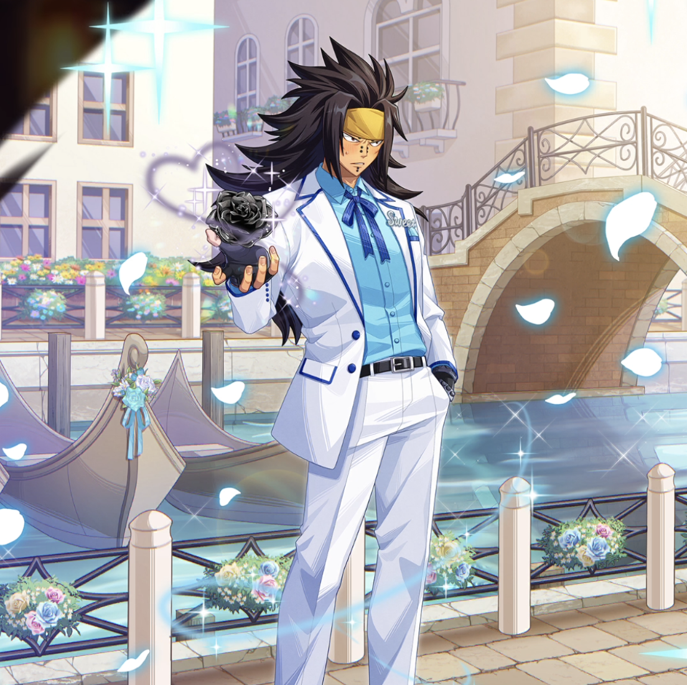

**Rarity:** UR

**Attribute:** 💙 Mind

**Class:** Disrupt

**Identity:** Gajeel Redfox

**Normal attack range:** Ranged

**Signature lacrima:** [[lacrimas/white-gift-gajeel-lacrima-3ab80bf2|✨ White Gift Gajeel Lacrima]]

## Game text

### 🗡️ Normal Skill (Ranged)

Deals 150% of ATK as damage to the target. After an attack hits, has a 20% chance to inflict &#91;High&#93; Bleed on the target for 2 seconds.

### 🗡️ Special Skill – Chain of Reciprocity

While you are on the field, inflicts &#91;High&#93; DEF Decrease and &#91;High&#93; Critical Resistance Decrease on all enemies.

### 💥 Ultimate – Black Rose of the Iron Dragon

Deals 850% of ATK as damage to enemies within range every 10 seconds. After an attack hits, has a 50% chance per target to inflict &#91;Top&#93; Bleed for 5 seconds and reduce the target&#x27;s charged Special SKill Gauge by 0.7 seconds.

## Effect applications

### High Bleed
| Property | Value |
| --- | --- |
| Family | Bleed |
| Target | Single Enemy |
| Activation | Normal SKill Hit |
| Chance | 20% |
| Duration | 2 sec |
| Value | 35 Percent of ATK per sec |
| Source skill | Normal Attack |

Deals 150% of ATK as damage to the target. After an attack hits, has a 20% chance to inflict &#91;High&#93; Bleed on the target for 2 seconds.

### High DEF Decrease
| Property | Value |
| --- | --- |
| Family | DEF |
| Target | All Enemies |
| Activation | While Unit is on the Field |
| Value | 25 Percent |
| Source skill | Special Skill |

While you are on the field, inflicts &#91;High&#93; DEF Decrease and &#91;High&#93; Critical Resistance Decrease on all enemies.

### High Critical Resistance Decrease
| Property | Value |
| --- | --- |
| Family | Critical Resistance |
| Target | All Enemies |
| Activation | While Unit is on the Field |
| Value | 15 Percent |
| Source skill | Special Skill |

While you are on the field, inflicts &#91;High&#93; DEF Decrease and &#91;High&#93; Critical Resistance Decrease on all enemies.

### Top Bleed
| Property | Value |
| --- | --- |
| Family | Bleed |
| Target | Each Target Hit |
| Activation | Every 10 sec, After Attack Hits |
| Chance | 50% |
| Duration | 5 sec |
| Value | 40 Percent of ATK per sec |
| Source skill | Ultimate |

After a successful hit, has a 50% chance to inflict for 5 sec &#91;Top&#93; Bleed on each target for 5 seconds

### Push Back Special Skill Gauge
| Property | Value |
| --- | --- |
| Family | Special Skill Gauge |
| Target | Each Target Hit |
| Activation | Every 10 sec, After Attack Hits |
| Chance | 50% |
| Value | 0.7 Seconds |
| Source skill | Ultimate |

Deals 850% of ATK as damage to enemies within range every 10 seconds. After an attack hits, has a 50% chance per target to inflict &#91;Top&#93; Bleed for 5 seconds and reduce the target&#x27;s charged Special SKill Gauge by 0.7 seconds.

Unspecified values remain unknown. Text is transcribed from game records; localization and entry errors may remain.
