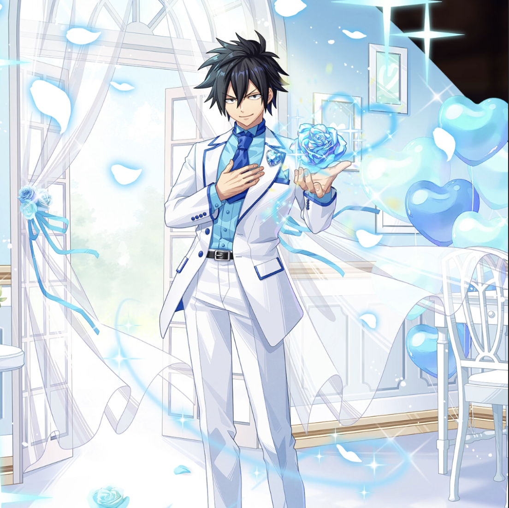

**Rarity:** UR

**Attribute:** ❤️ Brave

**Class:** Ranged

**Identity:** Gray Fullbuster

**Normal attack range:** Ranged

**Signature lacrima:** [[lacrimas/white-gift-gray-lacrima-209b96ea|✨ White Gift Gray Lacrima]]

## Game text

### 🗡️ Normal Skill (Ranged)

Deals 150% of ATK as damage to the target. After an attack hits, has a 10% chance to inflict &#91;High&#93; Freeze on the target for 2 seconds.

### 🗡️ Special Skill – Oath of Silver

Grants yourself &#91;Top&#93; ATK Increase and &#91;Top&#93; Accuracy Increase for 5 seconds every 5 seconds.

### 💥 Ultimate – Ice Make: White Gift

Deals 750% of ATK as damage to all enemies every 11 seconds. After an attack hits, has a 30% chance per target to inflict &#91;Top&#93; Freeze and &#91;Top&#93; DEF Decrease for 5 seconds.

## Effect applications

### High Freeze
| Property | Value |
| --- | --- |
| Family | Freeze |
| Target | Single Enemy |
| Activation | Normal SKill Hit |
| Chance | 10% |
| Duration | 2 sec |
| Source skill | Normal Attack |

Deals 150% of ATK as damage to the target. After an attack hits, has a 10% chance to inflict &#91;High&#93; Freeze on the target for 2 seconds.

### Top ATK Increase
| Property | Value |
| --- | --- |
| Family | ATK |
| Target | Self |
| Activation | Every 5 sec |
| Duration | 5 sec |
| Value | 30 Percent |
| Source skill | Special Skill |

Grants yourself &#91;Top&#93; ATK Increase and &#91;Top&#93; Accuracy Increase for 5 seconds every 5 seconds.

### Top Accuracy Increase
| Property | Value |
| --- | --- |
| Family | Accuracy |
| Target | Self |
| Activation | Every 5 sec |
| Duration | 5 sec |
| Value | 20 Percent |
| Source skill | Special Skill |

Grants yourself &#91;Top&#93; ATK Increase and &#91;Top&#93; Accuracy Increase for 5 seconds every 5 seconds.

### Top Freeze
| Property | Value |
| --- | --- |
| Family | Freeze |
| Target | Each Target Hit |
| Activation | Every 11 sec, After Attack Hits |
| Chance | 30% |
| Duration | 5 sec |
| Source skill | Ultimate |

Deals 750% of ATK as damage to all enemies every 11 seconds. After an attack hits, has a 30% chance per target to inflict &#91;Top&#93; Freeze and &#91;Top&#93; DEF Decrease for 5 seconds.

### Top DEF Decrease
| Property | Value |
| --- | --- |
| Family | DEF |
| Target | Each Target Hit |
| Activation | Every 11 sec, After Attack Hits |
| Chance | 30% |
| Duration | 5 sec |
| Value | 30 Percent |
| Source skill | Ultimate |

Deals 750% of ATK as damage to all enemies every 11 seconds. After an attack hits, has a 30% chance per target to inflict &#91;Top&#93; Freeze and &#91;Top&#93; DEF Decrease for 5 seconds.

Unspecified values remain unknown. Text is transcribed from game records; localization and entry errors may remain.
